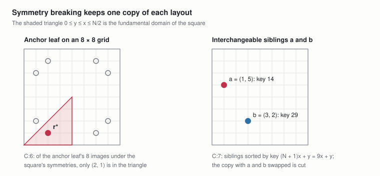

# TreeMaker foundations: leaf conditions and symmetry

Nov 2, 2026 · @Andrew Behn

This document defines the optional conditions that pin a leaf to a chosen place on the sheet or tie two leaves together as mirror images, and the two constraints that remove the sheet's equivalent copies of a layout, with the lemma that they keep an optimum. The base spec (Pure MILP), the symmetry-breaking spec, the optimized spec and the scalable spec use them. It builds on the tree, the grid and the spacing condition of the [sheet spec](https://claude.ai/artifact/Wkj6BjP3fGNPKLv3p3zW3C), and keeps its running example: the four-leaf tree on a 9 × 9 grid.

**Labels.** P:n, D:n and C:n number the parameters, shared definitions and constraints of this document, each kind in order of appearance. Other documents cite them with the short name conditions, as in conditions C:6. Labels of the sheet spec are written sheet D:2.

## 1. Notation

Notation follows the sheet spec (sheet Section 1). The symbols and terms below are added here.

| Symbol or term | Meaning |
| --- | --- |
| Dihedral group of the square | The 8 symmetries of the square \[0, N\]²: 4 rotations (0°, 90°, 180°, 270°) and 4 reflections |
| Fundamental domain | A region holding exactly one image of every point under those 8 symmetries; here the triangle 0 ≤ y ≤ x ≤ N/2 |
| Lexicographic order | Ordering points by x first, and by y when x ties |
| Copy of a layout | The layout moved by a symmetry of the square, or with interchangeable leaves swapped; it has the same scale |
| Valid tightening | An added constraint that removes only layouts with an equivalent copy that remains, so the optimum is unchanged |
| parent(i), eᵢ | For a leaf i: its one neighbour in the tree, and the edge joining them |

## 2. Leaf conditions

TreeMaker lets a design pin flaps to chosen places on the sheet, or tie two flaps together. On the grid each such condition is a linear equation in the leaf coordinates, so it joins any model of the spacing condition (sheet D:2) without changing the kind of model. Every condition only removes layouts, so it can lower m\* but never raise it. All but the mirror pair fix the bounds of a leaf's coordinates and add no rows; a mirror pair adds two rows. They apply to every stage that places or moves leaves.

### 2.1 Parameters

**P:1 Leaf conditions.** For each leaf, the set Aᵢ of grid points it may take, which is the whole grid, one side of the sheet, one corner, the symmetry axis or one fixed point, and a set 𝓜 of mirror pairs; the running example has none.

```math
A_i \subseteq G_N \ \ \forall\, i \in L, \qquad A_i \in \{\, G_N,\ \text{an edge (C:1)},\ \text{a corner (C:2)},\ \text{the axis (C:4)},\ \{(p, q)\} \text{ (C:5)} \,\}, \qquad \mathcal{M} \subseteq L \times L \ \text{(C:3)}
```

Used in: C:1 to C:5, D:1 and C:6; base Section 4, symmetry-breaking Section 2, scalable Section 1, M:2, A:2 and A:3.

### 2.2 Constraints

**C:1 Leaf on an edge.** The flap's tip lies on one side of the sheet, for the left, right, bottom or top side.

```math
x_i = 0, \qquad x_i = N, \qquad y_i = 0, \qquad y_i = N
```

Used in: Lemma 1; base Section 4 and Section 8.3, symmetry-breaking Section 3 and Section 5, scalable Section 1. The spacing condition only asks that the leaves lie on the sheet, so a leaf's circle of radius m·ℓ may already reach past the border, and the paper it would cover there is simply not needed. A leaf on an edge has half its circle off the sheet, which makes edge flaps cheap in paper; the condition forces this for a chosen flap, for example to keep a long flap on the border or to match where a known base puts it.

**C:2 Leaf in a corner.** The flap's tip lies at one of the corners (0, 0), (N, 0), (0, N) or (N, N), which fixes both coordinates.

```math
(x_i, y_i) = (0, 0), \qquad (N, 0), \qquad (0, N), \qquad (N, N)
```

Used in: Lemma 1; base Section 4 and Section 8.3, symmetry-breaking Section 3 and Section 5, scalable Section 1. Three quarters of a corner leaf's circle lies off the sheet, so corner flaps are the most economical, and the classic bases put their longest flaps there.

**C:3 Mirrored pair (book symmetry).** A mirror pair (a, b) ∈ 𝓜 puts leaf b at the mirror image of leaf a across the vertical line x = N/2.

```math
x_a + x_b = N, \qquad y_a = y_b \qquad \forall\, (a, b) \in \mathcal{M}
```

Used in: Lemma 1; base Section 4 and Section 8.3, symmetry-breaking Section 3 and Section 5, scalable Section 1, Section 3, M:3, A:2, M:6 and M:12. Symmetric subjects, with left and right legs, wings or antennae, are usually folded with book symmetry, so that each left flap folds like its right partner. These are the only conditions that add rows, two per pair. The line x = N/2 is a grid line only for even N; for odd N the pair still mirrors, about a line between two grid columns. The condition ties positions only: for a truly symmetric design the two flaps also need equal edge lengths. With every flap paired, about half the leaves are free, which also makes a model smaller to search.

**C:4 Leaf on the symmetry axis.** An unpaired flap of a symmetric subject, such as a head or a tail, lies on the mirror line itself.

```math
2 x_i = N
```

Used in: Lemma 1; base Section 4 and Section 8.3, symmetry-breaking Section 3 and Section 5, scalable Section 1. This needs an even N, so that x = N/2 is a grid line; for odd N no grid point lies on it, and the condition is refused.

**C:5 Leaf at a fixed point.** The flap's tip is pinned to a chosen grid point (p, q), for example to reproduce a known design or to try one placement.

```math
x_i = p, \qquad y_i = q, \qquad p,\ q \in \{0, 1, \dots, N\}
```

Used in: Lemma 1; base Section 4 and Section 8.3, symmetry-breaking Section 3 and Section 5, scalable Section 1.

## 3. Symmetry breaking

The square sheet looks the same after any of its 8 rotations and reflections, and two leaves with the same parent and the same edge length can trade places. Each of these turns a layout into an equally good one, so a solver meets every layout many times over. Two constraints keep one copy of each, and add no variables.

### 3.1 Parameters

**P:2 Anchor leaf.** One leaf, chosen in advance, that is in no pair of 𝒯 (D:1): the first such leaf, or none when every leaf is in a pair of 𝒯. In the running example any leaf will do; take leaf 1.

```math
r^{\ast} \in L, \qquad r^{\ast} \notin \{\, a, b : (a, b) \in \mathcal{T} \,\}
```

Used in: C:6 and Lemma 1; symmetry-breaking Section 3, optimized Section 2 and Section 3.1.

### 3.2 Shared definitions

**D:1 Interchangeable siblings.** Ordered pairs (a, b) of distinct leaves with the same parent, equal edge length and no leaf condition (P:1); a group of g such leaves contributes one pair for each consecutive two in a fixed listing of the group, g − 1 pairs in all.

```math
\mathcal{T} \subseteq L \times L, \qquad (a, b) \in \mathcal{T} \implies \mathrm{parent}(a) = \mathrm{parent}(b),\ \ \ell_{e_a} = \ell_{e_b},\ \ A_a = A_b = G_N,\ \ a, b \text{ in no pair of } \mathcal{M}
```

Used in: P:2, C:7 and Lemma 1; symmetry-breaking Section 1 and Section 3, optimized Section 2 and Section 3.1.

In the running example, leaves 1 and 2 share the parent u but have edge lengths 3 and 2, and leaves 3 and 4 share v but have lengths 2 and 4, so 𝒯 = ∅.

### 3.3 Constraints

**C:6 Anchor in the fundamental domain.** The anchor leaf lies in the triangle 0 ≤ y ≤ x ≤ N/2; the constraint applies only when there is an anchor and no leaf condition, because a condition fixes the sheet's orientation.

```math
2 x_{r^\ast} \leq N, \qquad 2 y_{r^\ast} \leq N, \qquad y_{r^\ast} \leq x_{r^\ast} \qquad \text{when } A_i = G_N \ \forall\, i \in L \text{ and } \mathcal{M} = \emptyset
```

Used in: Lemma 1; base Section 7 and Section 9, symmetry-breaking Sections 3 to 6, optimized Section 2, Sections 3.1 to 3.4, Section 4.1 and Section 4.2.

**C:7 Sibling order.** Interchangeable siblings appear in lexicographic order of their coordinates, through the key (N + 1)x + y.

```math
(N + 1)\, x_a + y_a \leq (N + 1)\, x_b + y_b \qquad \forall\, (a, b) \in \mathcal{T}
```

Used in: Lemma 1; base Section 7 and Section 9, symmetry-breaking Sections 3 to 6, optimized Section 2, Sections 3.1 to 3.4, Section 4.1 and Section 4.2.



*C:6 and C:7 · anchor in the fundamental domain, siblings in order*
On an 8 × 8 grid, an anchor leaf at (6, 1) has 8 images and only (2, 1) satisfies C:6; of two siblings, only the order with the smaller key first satisfies C:7. In the running example the optimal layout already has leaf 1 at (0, 0), inside the triangle, and 𝒯 is empty, so C:7 has no rows.

## 4. Why symmetry breaking keeps an optimum

**Lemma 1 (symmetry breaking keeps an optimum).** Every layout that meets the spacing condition (sheet D:2) at scale m and the leaf conditions C:1 to C:5 has a copy that meets them at the same scale and also satisfies C:6 and C:7. So C:6 and C:7 are a valid tightening, and the largest feasible scale is unchanged.

```math
\exists\, u \text{ feasible at } m \text{ with C:1–C:5} \iff \exists\, u' \text{ feasible at } m \text{ with C:1–C:7}
```

Used in: base Section 9, symmetry-breaking Section 5, optimized Section 3.4.

*Proof.*

- **The sheet's symmetries keep a layout feasible.** Each symmetry g of the square maps grid points to grid points and keeps every distance, so applying g to all leaves keeps every pair at its distance. C:6 is imposed only when no leaf has a condition, so there are no conditions for g to break.
- **Swapping interchangeable siblings keeps a layout feasible.** Two leaves a and b with the same parent and equal edge lengths have the same path length to every other leaf, and the pair {a, b} itself is unordered, so exchanging their points keeps every pair at its distance. Neither leaf carries a condition (D:1), so every condition still holds.
- **One copy satisfies C:6 and C:7.** Every point of the square has an image in the fundamental domain, so some symmetry g puts the anchor leaf there. Sorting each group of interchangeable siblings by its key then satisfies C:7. The key (N + 1)x + y takes a different value at every grid point, and two leaves never share a grid point at a positive scale, so the order is strict. Sorting does not move the anchor, because P:2 keeps the anchor out of every sibling pair.

**What it removes.** Without C:6 and C:7 each layout can appear up to 8 times from the sheet's symmetries, and g! times more for each group of g interchangeable siblings; the two constraints keep one copy. C:6 adds three rows and C:7 one row per sibling pair. The running example has no interchangeable siblings, so the factor there is at most 8. Translations of a layout with slack at the sheet's edges are not removed, and the constraints speed up a search without tightening an LP relaxation's bound.

```math
\text{copies removed per layout} \ \leq \ 8 \prod_{\text{sibling groups}} g!
```
