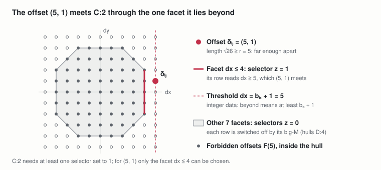
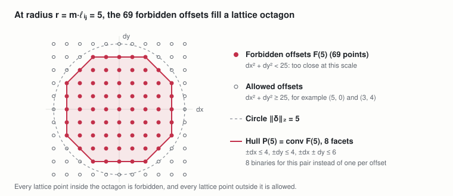
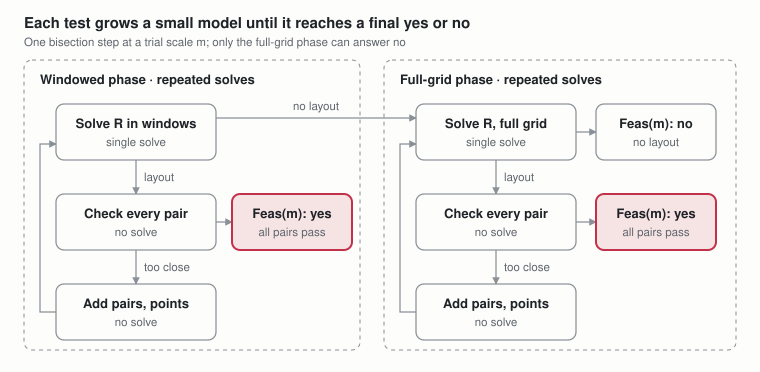
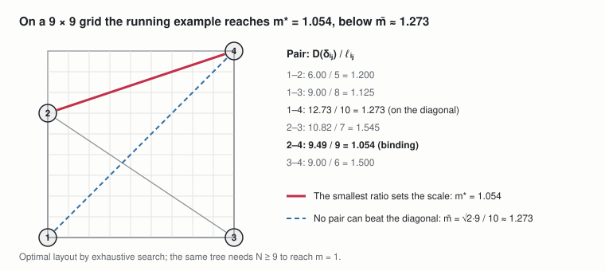
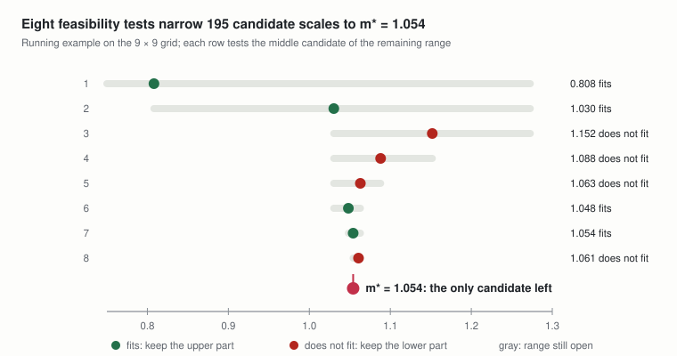
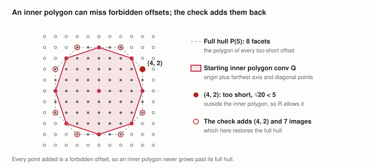
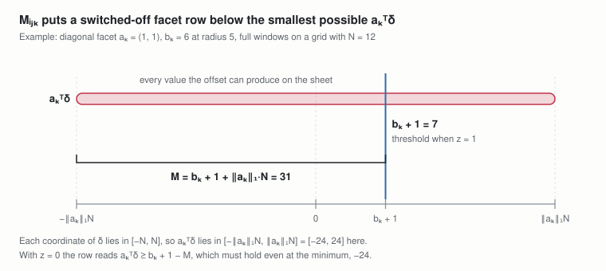
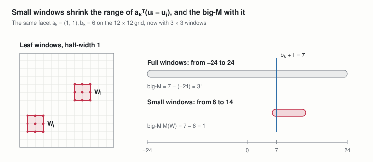
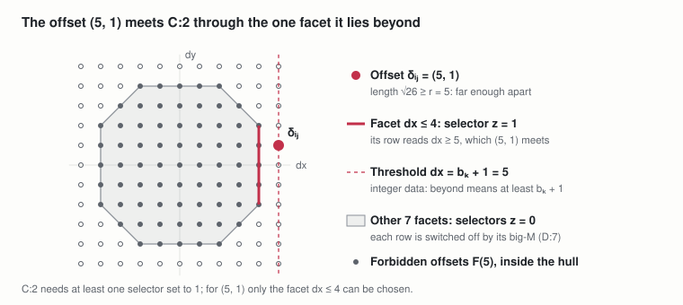

# Lattice-Hull MILP TreeMaker

Oct 25, 2026 · @Andrew Behn

An exact MILP formulation of TreeMaker's scale optimization on a fixed N × N grid, built for speed. It solves the same problem as [Pure MILP TreeMaker](https://claude.ai/artifact/1L1y2Ey5CzUT8AzfJ2sev4) and finds the same optimum, with much smaller models, by combining three ideas that depend on one another:

1. **Lattice hulls at a fixed scale.** At a fixed scale, a pair only needs to know whether its offset is too short. The too-short offsets fill a lattice polygon, so one binary per side of the polygon, a few dozen at most, replaces one binary per possible offset.
2. **Scale search.** Hulls exist only once the scale is fixed, so each model answers a yes-or-no question at one scale. The optimal scale is one of finitely many candidate values, and a bisection over them recovers the maximum.
3. **Incremental solving.** Each yes-or-no test starts from a small model, with a few pairs, simple polygons, and leaves confined to windows, and grows it only where a solution breaks a requirement.

This document restates everything it needs, so it can be read on its own. Symmetry breaking is independent of these ideas and can be added on top; see [Symmetry-Breaking MILP TreeMaker](https://claude.ai/artifact/4bhD37EK1NQy66fV4zhTaN).

Labels P:n, D:n, and C:n number the parameters, definitions, and constraints of this document, in order of appearance. Definitions used in more than one place are in Section 5. A definition used in one place only is given there.

## 1. From TreeMaker to fixed-scale lattice-hull models

**TreeMaker's scale optimization.** Lang's TreeMaker places the leaves of a weighted tree in the unit square and maximizes the scale m, the paper length per unit of tree length. Folding never stretches paper, so two flap tips must start at least as far apart on the sheet as their tree path length, times the scale.

```math
\max_{m,\ u} \ m \qquad \text{subject to} \qquad \|u_i - u_j\|_2 \geq m\, \ell_{ij} \ \ \forall\, \{i, j\} \in \mathcal{P}, \qquad u_i \in [0, 1]^2 \ \ \forall\, i \in L
```

**On a grid.** The sheet becomes an N × N grid with N chosen in advance, and every leaf must lie on a grid point. The offset between two leaves is then one of finitely many integer vectors, and the grid is the only approximation of TreeMaker.

**At a fixed scale.** If the scale m is fixed, each pair's requirement ‖uᵢ − uⱼ‖₂ ≥ m·ℓᵢⱼ says that its offset must avoid a fixed set of too-short grid offsets. Those offsets fill a lattice polygon, and avoiding them means lying beyond one of the polygon's sides, a choice among a few linear inequalities. That is what makes each fixed-scale model small. The price is that each model answers only whether a layout exists at that scale, so the largest scale is found by searching over scales.

**Leaves versus internal vertices.** Only leaves are placed. Internal vertices are not variables in TreeMaker's scale optimization: their positions are derived later, when the crease pattern is built from the active paths.

**Scale conversion.** TreeMaker's sheet has side 1 and this one has side N, so the two scales differ by a factor of N.

```math
m_{\mathrm{TreeMaker}} = m / N
```

## 2. Notation

Every symbol and term not defined in Sections 3–8 is listed here.

| Symbol or term | Meaning |
| --- | --- |
| ∅ | The empty set |
| x ∈ X, X ⊆ Y | x is an element of X; X is a subset of Y |
| X \\ Y, X ∪ Y | Set difference: elements of X not in Y; union: elements in X or Y |
| X × Y | Cartesian product: all ordered pairs (x, y) with x ∈ X, y ∈ Y |
| \|X\| | Cardinality: the number of elements of X |
| {i, j} | An unordered pair, so {i, j} = {j, i} |
| ∀, ⟹, ⟺ | For all; implies; if and only if |
| ∑, max, min | Sum over, largest value over, and smallest value over the indexed set |
| ℤ, ℤ≥₁ | The integers; the positive integers |
| ℝ, ℝ² | The real numbers; the real plane |
| \[a, b\] | The closed interval of reals from a to b |
| {0, 1} | The binary values; a variable in it is a binary (0/1) variable |
| {a, …, b} | The integers from a to b inclusive |
| ‖δ‖₂ | Euclidean norm √(δ₁² + δ₂²) of a plane vector |
| aᵀδ | Inner product a₁δ₁ + a₂δ₂ of two plane vectors |
| ‖a‖₁ | L1 norm \|a₁\| + \|a₂\| |
| gcd(p, q) | Greatest common divisor of two integers |
| ⌈x⌉, log₂ | The smallest integer at least x; logarithm base 2 |
| deg(v) | Degree: the number of edges incident to vertex v |
| path(u, v) | The edges on the unique path between u and v in a tree |
| Grid point | A point of the sheet whose two coordinates are both integers |
| conv(X) | Convex hull: the smallest convex set containing X |
| Lattice polygon | A polygon whose vertices are all points of ℤ² |
| Facet | One side of a convex polygon, written as a half-plane aᵀδ ≤ b that the polygon satisfies, with equality along that side |
| Crossable facet | A facet that at least one grid offset in {−N, …, N}² lies strictly beyond |
| Big-M constant | A constant large enough that a constraint relaxed by M·(1 − binary) always holds when the binary is 0 |
| Tight (binding) pair | A leaf pair whose distance equals its required minimum, ‖uᵢ − uⱼ‖₂ = m·ℓᵢⱼ. Tight pairs limit the scale: any larger scale would put them too close. |
| Feasible, infeasible | A layout is feasible when it satisfies every constraint of a model. A model is feasible when it has such a layout and infeasible when it has none; a scale m is feasible when Feas(m) is. |
| Trial scale | A fixed value of the scale m that one model tests (P:4) |
| Bisection | Repeatedly halving a sorted range by testing its middle value |
| Relaxation, restriction | A relaxation of a model drops requirements, so it keeps every layout of the model and may admit more. A restriction drops options, so it keeps only some of them. |
| LP relaxation | The model with its integer requirements dropped, which MILP solvers solve to get bounds |
| Branch-and-bound | The search MILP solvers use: split on variables that come out fractional, and discard branches whose LP relaxation cannot succeed |
| Contact graph | For a set of non-overlapping circles, the graph with one edge per pair of touching circles |

**Solver-use labels.** The procedure of Section 10 marks each step with how it uses the solver:

- **No solve:** arithmetic or precomputation only; no MILP is solved.
- **Single solve:** one MILP model, built once and solved once.
- **Repeated solves:** a loop whose passes each contain at least one single solve. The number of passes is not fixed in advance.

## 3. Sets and spaces

**Leaves.** The leaves of the input tree T = (V, E) (Section 4) are its vertices of degree 1, the flap tips; n is their number.

```math
L = \{\, v \in V : \deg(v) = 1 \,\} \subseteq V, \qquad n = |L|
```

**Leaf pairs.** The set of unordered pairs of distinct leaves.

```math
\mathcal{P} = \{\, \{i, j\} : i, j \in L,\ i \neq j \,\}
```

**Integer lattice and grid.** The integer lattice ℤ² is the set of points whose two coordinates are both integers. The sheet is the square \[0, N\]², and its grid points are the lattice points it contains.

```math
\mathbb{Z}^2 = \{\, (p, q) : p, q \in \mathbb{Z} \,\}, \qquad G_N = \mathbb{Z}^2 \cap [0, N]^2 = \{0, 1, \dots, N\}^2, \qquad |G_N| = (N + 1)^2
```

**Pair offsets.** The offset of a leaf pair is the difference of the two leaves' positions uᵢ (Section 6). Fix an order i < j for each pair so the offset has a sign.

```math
\delta_{ij} = u_i - u_j \in \mathbb{Z}^2 \qquad \forall\, \{i, j\} \in \mathcal{P},\ i < j
```

**Candidate offsets.** Every value a pair offset can take on the N × N grid. Both coordinates of two grid points lie in {0, …, N}, so their difference lies in {−N, …, N}². The zero offset is excluded because two leaves cannot share a grid point when the scale is positive.

```math
\Delta_N = \{-N, \dots, N\}^2 \setminus \{(0, 0)\}, \qquad |\Delta_N| = (2N + 1)^2 - 1, \qquad \delta_{ij} \in \Delta_N \ \ \forall\, \{i, j\} \in \mathcal{P}
```

## 4. Parameters

P:1–P:3 describe the problem and stay fixed throughout. P:4–P:7 are fixed for one solve and set by the procedure of Section 10.

**P:1 Tree.** The input tree: a finite vertex set V and an edge set E saying which vertices are joined. A tree is connected and has no cycles, so it has exactly one fewer edge than vertices.

```math
T = (V, E), \qquad E \subseteq \{\, \{u, v\} : u, v \in V,\ u \neq v \,\}, \qquad T \text{ connected}, \qquad |E| = |V| - 1
```

**P:2 Edge lengths.** Positive edge lengths in tree units. They need not be integers: the scale m converts them to grid units.

```math
\ell_e > 0 \qquad \forall\, e \in E
```

**P:3 Grid size.** The number of grid squares along each side of the sheet, fixed in advance.

```math
N \in \mathbb{Z}_{\geq 1}
```

**P:4 Trial scale.** The scale tested by one solve. It is a parameter, not a variable; the procedure takes its values from the candidate scales of D:5.

```math
m > 0
```

**P:5 Active pairs.** The pairs whose spacing rows are in the model. All other pairs are left out and checked after the solve.

```math
A \subseteq \mathcal{P}
```

**P:6 Inner polygon points.** For each active pair, a set of its forbidden offsets at the trial scale (D:2).

```math
Q_{ij} \subseteq F(m\, \ell_{ij}) \qquad \forall\, \{i, j\} \in A
```

**P:7 Leaf windows.** For each leaf, a box of the grid with integer bounds. Full windows, Wᵢ = \[0, N\]², allow the whole sheet.

```math
W_i = [\underline{x}_i, \overline{x}_i] \times [\underline{y}_i, \overline{y}_i] \subseteq [0, N]^2 \qquad \forall\, i \in L
```

## 5. Shared definitions

Every quantity below is computed before solving, from the parameters; D:2 and D:6 also depend on the trial scale. D:3 and D:4 are used only by D:5, so they come just before it. D:7, used only by C:2, is given with C:2 in Section 7. The diagrams use one running example: a tree with four leaves and two internal vertices u and v.

**D:1 Tree metric and path lengths.** The tree metric d is the total edge length along the unique path between two vertices. Between two leaves it gives the path length ℓᵢⱼ, which the scale converts into that pair's minimum separation. The largest path length is ℓmax.

```math
d(u, v) = \sum_{e \in \mathrm{path}(u, v)} \ell_e, \qquad \ell_{ij} = d(i, j) \ \ \forall\, \{i, j\} \in \mathcal{P}, \qquad \ell_{\max} = \max_{\{i, j\} \in \mathcal{P}} \ell_{ij}
```

Used in: D:2, D:4, and D:5.



*example tree · path lengths between leaves*
In the running example, leaves 1 and 4 are farthest apart along the tree, so ℓmax = 10.

**D:2 Forbidden offsets and their lattice hull.** For a radius r: the grid offsets shorter than r, their convex hull P(r), and its facets K(r), written with integer coefficients. Facets that no offset in {−N, …, N}² can cross are left out of K(r). A pair at trial scale m uses the radius r = m·ℓᵢⱼ.

```math
F(r) = \{\, \delta \in \{-N, \dots, N\}^2 : \|\delta\|_2 < r \,\}, \qquad P(r) = \operatorname{conv} F(r) = \{\, \delta \in \mathbb{R}^2 : a_k^{\top} \delta \leq b_k \ \ \forall\, k \in K(r) \,\}, \qquad a_k \in \mathbb{Z}^2,\ \gcd(a_{k1}, a_{k2}) = 1,\ b_k \in \mathbb{Z}
```

Used in: P:6, D:6, and the starting choices of the procedure.



*forbidden offsets at radius 5 · lattice octagon and its 8 facets*
**D:3 Offset distance lookup table.** The Euclidean length of every candidate offset in Δ\_N. It depends only on N.

```math
D : \Delta_N \to \mathbb{R}_{> 0}, \qquad D(\delta) = \|\delta\|_2 = \sqrt{\delta_1^2 + \delta_2^2}, \qquad D(\pm\delta_1, \pm\delta_2) = D(\delta_1, \delta_2)
```

Used in: the candidate scales D:5. No constraint reads it; the hulls of D:2 replace it inside the model.



*offset distance lookup table · quadrant for N = 5*
**D:4 Scale upper bound.** No two grid points are farther apart than the sheet's diagonal, √2·N, and the pair with the longest path needs m·ℓmax of that.

```math
\bar{m} = \frac{\sqrt{2}\, N}{\ell_{\max}}
```

Used in: the candidate scales D:5.



*running example on a 9 × 9 grid · binding pair and diagonal bound*
The bound is usually loose because other pairs also need room. In the running example it is reached by the diagonal pair 1–4, but pair 2–4 binds first (becomes tight, exactly at its minimum distance, at a smaller scale).

**D:5 Candidate scales.** Every lookup-table distance divided by a pair's path length, up to the scale bound m̄. They are sorted as c₁ < c₂ < … < c\_K.

```math
\mathcal{C} = \left\{ \frac{D(\delta)}{\ell_{ij}} : \delta \in \Delta_N,\ \{i, j\} \in \mathcal{P} \right\} \cap [0, \bar{m}] = \{\, c_1 < c_2 < \dots < c_K \,\}
```

Used in: the objective (Section 9) and the bisection (Section 10).



*bisection over candidate scales · running example, 9 × 9 grid*
For the running example, the 9 × 9 grid has 50 distinct squared lengths and the tree 6 path lengths, giving 195 candidates up to m̄ ≈ 1.273.

**D:6 Inner polygon.** The lattice hull of an active pair's points Qᵢⱼ (P:6), with facets K(Qᵢⱼ) written with integer data as in D:2. With Qᵢⱼ = F(m·ℓᵢⱼ) it is the full hull P(m·ℓᵢⱼ).

```math
\operatorname{conv} Q_{ij} = \{\, \delta : a_k^{\top} \delta \leq b_k \ \ \forall\, k \in K(Q_{ij}) \,\} \subseteq P(m\, \ell_{ij})
```

Used in: the facet selectors and C:2.



*D:6 · starting inner polygon at radius 5 and an offset it misses*
The starting inner polygon misses the forbidden offset (4, 2). If a solution uses it, the check of Section 10 adds it and its images, which at radius 5 restores the full hull.

## 6. Variables

The scale is not a variable: it is the trial scale P:4 of each solve.

**Leaf coordinates.** Integer coordinates, so each leaf sits on a grid point (C:1).

```math
x_i,\ y_i \in \mathbb{Z} \cap [0, N], \qquad u_i = (x_i, y_i) \qquad \forall\, i \in L
```

**Facet selectors.** For each active pair, one binary per facet of its inner polygon; 1 means the pair lies beyond that facet.

```math
z_{ijk} \in \{0, 1\} \qquad \forall\, \{i, j\} \in A,\ k \in K(Q_{ij})
```

## 7. Constraints

**C:1 Leaves on grid points in their windows.** Every leaf lies on a grid point inside its window. With full windows this is the whole N × N sheet.

```math
u_i \in W_i \cap G_N \qquad \forall\, i \in L
```

**D:7 Facet big-M.** For each active pair and facet of its inner polygon, the constant that switches that facet's row of C:2 off when its selector is 0. It is computed from the windows, coordinate by coordinate; with full windows it is bₖ + 1 + ‖aₖ‖₁·N. A facet that cannot be crossed inside the windows is left out.

```math
M_{ijk} = b_k + 1 - \min_{u_i \in W_i,\ u_j \in W_j} a_k^{\top} (u_i - u_j), \qquad W_i = W_j = [0, N]^2 \ \Longrightarrow\ M_{ijk} = b_k + 1 + \|a_k\|_1\, N
```

Used in: C:2.



*D:7 with full windows · range of aₖᵀδ against the threshold*


*D:7 with small windows · the big-M falls from 31 to 1*
With both leaves confined to 3 × 3 windows, the facet row's left side ranges over 6 to 14 instead of −24 to 24, and the big-M falls from 31 to 1.

**C:2 Spacing through the inner polygons.** Each active pair's offset lies strictly outside its inner polygon, beyond at least one facet.

```math
\begin{aligned}
&a_k^{\top} (u_i - u_j) \geq b_k + 1 - M_{ijk} (1 - z_{ijk}) && \forall\, k \in K(Q_{ij}) \\
&\textstyle\sum_{k \in K(Q_{ij})} z_{ijk} \geq 1
\end{aligned}
\qquad \forall\, \{i, j\} \in A
```



*C:2 · an offset beyond one facet of its hull at radius 5*
With the full hull at radius 5, the offset (5, 1) lies beyond exactly one facet, so that facet's selector is the only one that can be 1.

## 8. Models

Both models below have no objective: each asks whether a layout exists at one trial scale.

**The restricted model R (single solve).** C:1 and C:2 over the leaf coordinates and facet selectors, for given P:4–P:7. Every solve in the procedure is one solve of R.

```math
\mathrm{R}(m; A, Q, W): \quad \text{find } u, z \ \text{ satisfying C:1 and C:2}
```

**The full feasibility model Feas(m).** R with every pair active, every inner polygon equal to its full hull, and full windows. It is the lattice-hull model of TreeMaker at scale m: it has a solution exactly when a grid layout exists with every pair at least m·ℓᵢⱼ apart (Section 11).

```math
\mathrm{Feas}(m) = \mathrm{R}\big(m;\ \mathcal{P},\ Q^{\mathrm{full}},\ W^{\mathrm{full}}\big), \qquad Q^{\mathrm{full}}_{ij} = F(m\, \ell_{ij}), \qquad W^{\mathrm{full}}_i = [0, N]^2
```

The procedure never has to build Feas(m) in full. It decides the same question with smaller models R, and uses Feas(m) only as the yardstick for what is exact.

## 9. Objective

Maximize the scale, exactly as TreeMaker does, over the candidate scales of D:5. Because each model fixes the scale, the maximum is taken outside the solver, by the bisection of Section 10.

```math
m^{*} = \max \{\, m \in \mathcal{C} : \mathrm{Feas}(m) \text{ has a solution} \,\}
```

For the running example, m\* = 1.054 on the 9 × 9 grid, with pair 2–4 tight.

## 10. Procedure

### 10.1 Levels

| Level | Step | Solver use | Where |
| --- | --- | --- | --- |
| 0 | Setup: candidate scales, hulls, and the rounded TreeMaker layout | No solve (plus one continuous TreeMaker solve, which is not a MILP) | D:2, D:5, 10.5 |
| 1 | Bisection over candidate scales | Repeated solves: at most ⌈log₂ K⌉ tests | 10.2 |
| 2 | One test at a trial scale m | Repeated solves: a windowed phase, then a full-grid phase only if needed | 10.3 |
| 3 | One phase: the generation loop | Repeated solves: one round per pass | 10.4 |
| 4 | One round: the restricted model R | Single solve | Section 8 |
| 5 | The check after each round | No solve | 10.4 |

### 10.2 Bisection over candidate scales (repeated solves)

1. Sort the candidates of D:5: c₁ < c₂ < … < c\_K. No solve.
2. Set lo to the index of any candidate known to be feasible, and hi = K. The rounded TreeMaker layout of 10.5 gives one, at least N·m\_TM − √2/ℓ\_min, where m\_TM is TreeMaker's continuous optimum and ℓ\_min the shortest leaf path; without it, use lo = 1. No solve.
3. While lo < hi: test the middle candidate c\_mid, with mid = ⌈(lo + hi)/2⌉, by the test of 10.3. If Feas(c\_mid) has a solution, set lo = mid and keep the layout; otherwise set hi = mid − 1.
4. Return m\* = c\_lo and the last layout found. No solve.

### 10.3 One test at a trial scale (repeated solves)

1. **Windowed phase.** Repeated solves. Set the windows around the window center layout: the last feasible layout found, or at the first test the rounded TreeMaker layout. Run the generation loop. A "yes" is final. If R has no layout, go to phase 2.
2. **Full-grid phase.** Repeated solves, run only when the windowed phase fails. Run the generation loop again with full windows, starting from the A and Q the windowed phase built. Its "yes" or "no" is final.


*one bisection step · windowed phase, then full-grid phase*
### 10.4 The generation loop (repeated solves)

The loop takes a trial scale m, a set of windows, and the current A and Q. Each pass:

1. **Solve R(m; A, Q, W).** Single solve.
2. **If R has no layout,** stop. With full windows, the test's answer is a final "no". With smaller windows, the phase has failed and says nothing about Feas(m).
3. **Check the layout.** No solve. For every pair in 𝒫, compare ‖δᵢⱼ‖₂ with m·ℓᵢⱼ. For each pair that is too close: if the pair is not active, add it to A, with its starting points plus the offending offset δᵢⱼ; if it is active, its inner polygon was too small, so add δᵢⱼ to Qᵢⱼ, together with its images under the 8 symmetries of the square.
4. **If no pair was too close,** stop: the test's answer is a final "yes". Otherwise return to 1.

### 10.5 Starting choices (no solve)

- **Rounded TreeMaker layout:** solve TreeMaker's continuous model once, scale its layout by N, and move each leaf to its nearest grid point. Each leaf moves at most √2/2, so every pair distance shrinks by at most √2, which gives the feasible candidate of 10.2.
- **Active pairs:** the pairs that are tight or nearly tight (at, or close to, their minimum distance) in the window center layout, plus every pair of leaves that share a parent.
- **Inner polygon points:** the origin and the points of F(m·ℓᵢⱼ) farthest along the four axis and four diagonal directions, which gives at most 8 facets. Setting Qᵢⱼ = F(m·ℓᵢⱼ) gives the full hull back and turns facet generation off.
- **Windows:** a box of half-width h around each leaf of the window center layout, clipped to the grid. h is a tuning choice; it changes how fast a test runs, not its answer.

### 10.6 What carries from one test to the next (no solve)

The bisection moves up after a "yes" and down after a "no".

| Item | To a higher trial scale | To a lower trial scale m′ |
| --- | --- | --- |
| Active pairs A | Kept | Kept |
| Inner polygon points Q | Kept | Kept only while ‖δ‖₂ < m′·ℓᵢⱼ; then the new scale's starting points are added |
| Window center layout | The last feasible layout | The last feasible layout |

Each feasible layout can also be passed to the next solve as a starting solution.

## 11. Why it is exact

**Feas(m) is TreeMaker on the grid at scale m.**

- **The hull holds exactly the too-short offsets.** P(r) is the convex hull of points inside the circle of radius r, so it lies inside that circle, and the lattice points it contains are exactly F(r). A grid offset is too short exactly when it lies in P(r).
- **The +1 shift is exact.** The facet data are integers, so for a lattice offset, lying strictly beyond facet k is the same as reaching bₖ + 1.
- **The big-M is large enough.** D:7 subtracts the smallest value aₖᵀ(uᵢ − uⱼ) can take inside the windows, so a row whose selector is 0 always holds there.
- **Leaving out uncrossable facets loses nothing,** because no offset in the windows could use them.

```math
\delta \in \{-N, \dots, N\}^2: \quad \delta \notin P(r) \iff \|\delta\|_2 \geq r, \qquad a_k^{\top} \delta > b_k \iff a_k^{\top} \delta \geq b_k + 1, \qquad \mathrm{Feas}(m) \iff \|u_i - u_j\|_2 \geq m\, \ell_{ij} \ \ \forall\, \{i, j\} \in \mathcal{P}
```

**The bisection finds the maximum.**

- **m* is a candidate.*\* At an optimal layout some pair is tight; otherwise every pair would have room to spare and the same layout would work at a slightly larger scale. That pair's distance is a table value D(δ) and equals m\*·ℓᵢⱼ, so m\* = D(δ)/ℓᵢⱼ, and m\* ≤ m̄.
- **Feasibility is monotone in the scale.** A layout that works at scale m also works at every smaller scale, because each pair's required distance only shrinks. The sorted candidates split into a feasible lower part and an infeasible upper part, and bisection finds the boundary.

```math
m^{*} \in \mathcal{C}, \qquad \mathrm{Feas}(m) \text{ has a solution and } m' \leq m \ \Longrightarrow\ \mathrm{Feas}(m') \text{ has a solution}
```

**Each test answers Feas(m) exactly.**

- **Full-window solves settle "no".** With full windows, R keeps only some pairs, and each inner polygon lies inside its full hull, so being outside it is a weaker requirement. R is then a relaxation (it drops requirements) of Feas(m): if it has no layout, neither does Feas(m).
- **Checked layouts settle "yes".** The check tests every pair against its true minimum distance, and every layout of R has its leaves on grid points. A layout that passes the check satisfies Feas(m), whatever windows were used; small windows only drop options, a restriction.
- **A windowed "no" is never used as an answer.** It only sends the test to the full-grid phase.
- **The added points are forbidden.** A too-short offset lies in F(m·ℓᵢⱼ), and so do its 8 images, because F depends only on length.
- **The loop ends.** Every pass that does not stop adds at least one pair or one lattice point, and there are finitely many of both. In the worst case R grows into Feas(m).
- **The carried state stays valid.** Any subset of the real pairs gives a relaxation at every scale, so A carries both ways. The forbidden sets are nested, so points carry upward; at a lower scale some points may be long enough, and keeping them would forbid valid offsets, so they are dropped.

```math
m < m' \ \Longrightarrow\ F(m\, \ell_{ij}) \subseteq F(m'\, \ell_{ij})
```

## 12. Model size and costs

The comparison is with the selector model of Pure MILP TreeMaker, which gives each pair one binary per candidate offset, (2N + 1)² − 1 per pair, and finds m\* in one solve.

**Binaries per pair, full hulls.** A hull's crossable facet count grows only like r^(2/3), with r ≤ √2·N on the sheet.

| Grid | Selector model: binaries per pair | Full hull: facets per pair, worst case over all scales |
| --- | --- | --- |
| N = 9 | 360 | 20 |
| N = 16 | 1,088 | 28 |
| N = 32 | 4,224 | 48 |

**Whole models, full hulls.** Binaries in Feas(m) with every pair active and full windows; the number of tests is at most ⌈log₂|𝒞|⌉.

| Instance | Selector model, one solve | Feas(m), per test | Tests |
| --- | --- | --- | --- |
| Running example, 4 leaves, N = 9 | 2,160 | 56 to 80 | 8 |
| 20 leaves, N = 32 | 802,560 | at most 9,120 | at most 17 |
| 50 leaves, N = 32 | 5,174,400 | at most 58,800 | at most 20 |

At the running example's optimum, the six pairs' hulls have 72 crossable facets in total. Summed over all eight tests, it uses 564 binaries, a quarter of the selector model's 2,160, and each solve is a far smaller search.

**Incremental solving.** Each round of R has one binary per facet of each active pair's inner polygon, instead of one per crossable facet of every pair's full hull.

```math
\underbrace{\textstyle\sum_{\{i, j\} \in A} |K(Q_{ij})|}_{\text{one round of R}} \quad \text{instead of} \quad \underbrace{\textstyle\sum_{\{i, j\} \in \mathcal{P}} |K(m\, \ell_{ij})|}_{\mathrm{Feas}(m)}
```

Binding pairs in TreeMaker layouts tend to form a sparse, roughly planar pattern, like the contact graph of a circle packing, which has at most 3n − 6 edges. If the active set stays near that size, a 50-leaf tree on a 32 × 32 grid needs about 150 active pairs with at most 48 facets each: about 7,200 binaries per round, against at most 58,800 for Feas(m). Small windows also give small big-Ms and a tighter LP relaxation. The running example, with only six pairs, is too small to gain from pair generation.

**Rows and nonzeros.** Each facet row of C:2 touches at most five variables (four coordinates and its selector), so a pair has at most 6|K(Qᵢⱼ)| nonzeros, against about 4(2N + 1)² in the selector model.

```math
\underbrace{O(n^2 N^2)}_{\text{selector model: one solve}}
\quad \longrightarrow \quad
\underbrace{O\big(n^2 N^{2/3}\big)}_{\text{Feas}(m)\text{, per test}} \ \times \ \underbrace{O\big(\log (N^2 n^2)\big)}_{\text{tests}}
```

**The costs.**

- **The scale is fixed in each solve.** The selector model reads the exact length of whichever offset a pair takes, so m can stay a variable. The hull test only says whether an offset is too short at one radius, and P(r) changes with r = m·ℓᵢⱼ. If m stayed a variable, each pair would need a different polygon for every value m could take, which brings back much of the size the hulls remove. So several small solves replace one large one.
- **Big-M constants.** The selector model needs none. D:7 is the price of the smaller selector set, and it keeps the LP relaxation weak: averaging two facet choices can place leaves too close in the relaxation. The gains come from much smaller searches, not from a tighter bound.
- **More rounds per test.** Their number has no useful bound in advance; it depends on how well the starting set guesses the binding pairs.
- **The expensive tests.** The tests that prove infeasibility (that no layout exists), just above m\*, are usually the hardest, and only the full-grid phase can settle them.
