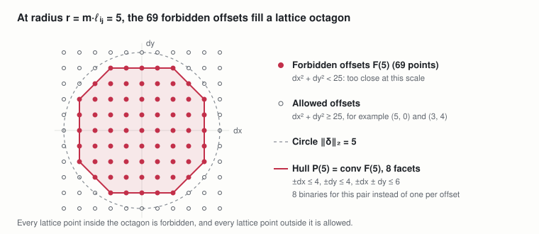
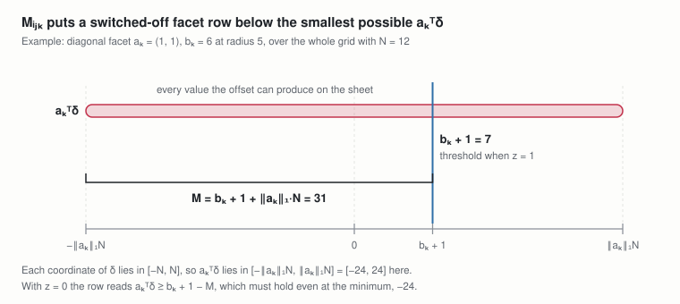
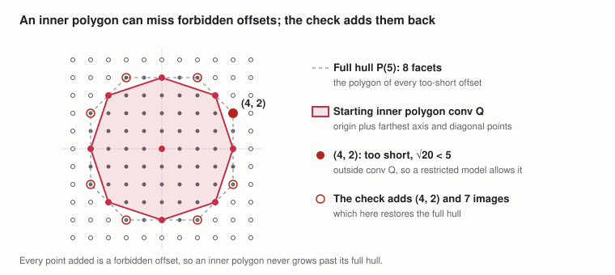
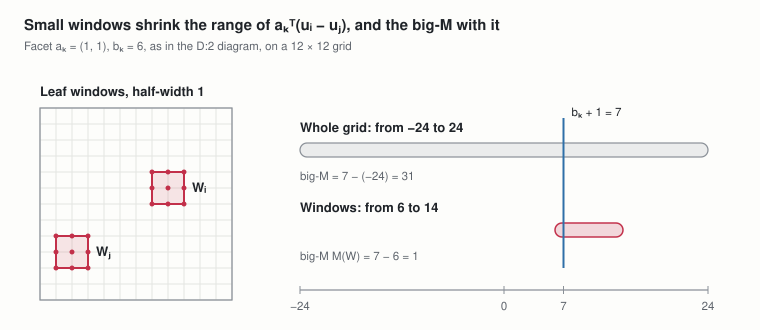

# TreeMaker foundations: lattice hulls and leaf windows

Nov 2, 2026 · @Andrew Behn

This document defines, for one pair at a fixed scale, the lattice polygon that holds its too-short grid offsets and the big-M constant that switches each of the polygon's facet rows, and then the smaller inner polygons and leaf windows that incremental models use in their place. The lattice-hull spec and the optimized spec use all of it, and the scalable spec uses the same forbidden offsets and windows. It builds on the tree, grid and spacing condition of the [sheet spec](https://claude.ai/artifact/Wkj6BjP3fGNPKLv3p3zW3C) and the candidate offsets of the [offsets spec](https://claude.ai/artifact/DLXohGDzg22AYwjJeHyYem).

**Labels.** P:n and D:n number the parameters and shared definitions of this document, each kind in order of appearance. Other documents cite them with the short name hulls, as in hulls D:1. Labels of the sheet and offsets specs are written sheet D:2 and offsets D:1.

## 1. Notation

Notation follows the sheet spec (sheet Section 1). The symbols and terms below are added here.

| Symbol or term | Meaning |
| --- | --- |
| X ∪ Y | Union: the elements in X or Y |
| aᵀδ | Inner product a₁δ₁ + a₂δ₂ of two plane vectors |
| ‖a‖₁ | L1 norm: the sum of the absolute values of a₁ and a₂ |
| gcd(p, q) | Greatest common divisor of two integers |
| conv(X) | Convex hull: the smallest convex set containing X |
| Lattice polygon | A polygon whose vertices are all points of ℤ² |
| Facet | One side of a convex polygon, written as a half-plane aᵀδ ≤ b that the polygon satisfies, with equality along that side |
| Crossable facet | A facet that at least one grid offset in {−N, …, N}² lies strictly beyond |
| Big-M constant | A constant large enough that a row relaxed by M·(1 − z) always holds when the binary z is 0 |
| Trial scale | A fixed value of the scale m that one model tests; a pair at trial scale m has radius r = m·ℓᵢⱼ |
| Facet selector zᵢⱼₖ | A binary that is 1 when the offset of pair {i, j} lies beyond facet k |
| Relaxation, restriction | A relaxation of a model drops requirements, so it keeps every layout of the model and may admit more. A restriction drops options, so it keeps only some of them. |

## 2. The lattice hull

At a fixed scale, the spacing condition of sheet D:2 asks of each pair only that its offset avoid a fixed set of too-short grid offsets. Those offsets fill a lattice polygon, and avoiding it means lying beyond one of its sides: a choice among a few linear rows instead of one binary per candidate offset (offsets D:1).

**D:1 Forbidden offsets and their lattice hull.** For a radius r: the grid offsets shorter than r, their convex hull P(r), and its facets K(r), written with integer coefficients; facets that no offset in {−N, …, N}² can cross are left out of K(r), and a pair at trial scale m uses r = m·ℓᵢⱼ.

```math
F(r) = \{\, \delta \in \{-N, \dots, N\}^2 : \|\delta\|_2 < r \,\}, \qquad P(r) = \operatorname{conv} F(r) = \{\, \delta \in \mathbb{R}^2 : a_k^{\top} \delta \leq b_k \ \ \forall\, k \in K(r) \,\}, \qquad a_k \in \mathbb{Z}^2,\ \gcd(a_{k1}, a_{k2}) = 1,\ b_k \in \mathbb{Z}
```

Used in: D:2, P:2, D:3 and Section 5; lattice-hull Section 2 and Section 8.1, optimized Section 4.1, scalable D:1 (the same set, tested as dx² + dy² ≤ L(r)).



*forbidden offsets at radius 5 · lattice octagon and its 8 facets*
At radius 5 the hull is an octagon with 8 facets, so a pair needs 8 facet selectors in place of one binary per candidate offset. A pair keeps its offset outside P(r) through one row per facet, aₖᵀ(uᵢ − uⱼ) ≥ bₖ + 1 − Mᵢⱼₖ(1 − zᵢⱼₖ), and the requirement that at least one of its selectors be 1.

**D:2 Facet big-M.** For each pair and facet, the constant that switches that facet's row off when its selector is 0, computed over the whole grid: every coordinate of an offset lies in \[−N, N\], so aₖᵀδ ≥ −‖aₖ‖₁N.

```math
M_{ijk} = b_k + 1 + \|a_k\|_1\, N
```

Used in: D:4 and Section 5; lattice-hull C:2 (the full-window case of D:4) and Section 9, optimized Section 4.2.



*facet big-M with full windows · range of aₖᵀδ against the threshold*
On a 12 × 12 grid the diagonal facet aₖ = (1, 1), bₖ = 6 of the radius-5 octagon ranges over −24 to 24, so its switched-off row must reach down to −24 and the big-M is 7 + 24 = 31.

## 3. Parameters of a restricted model

An incremental model keeps only some of the pairs, only part of each pair's hull, and each leaf in a box of the grid. The three parameters below say which; a procedure sets them for one solve and grows them between solves.

**P:1 Active pairs.** The pairs whose facet rows are in the model; every other pair is left out and checked after the solve.

```math
A \subseteq \mathcal{P}
```

Used in: P:2 and D:3; lattice-hull P:1, Section 4 and Section 6, optimized Section 2.

**P:2 Inner polygon points.** For each active pair, a set of its forbidden offsets at the trial scale (D:1); a usual starting set is the origin and the points of F(m·ℓᵢⱼ) farthest along the four axis and four diagonal directions, which gives at most 8 facets, and Qᵢⱼ = F(m·ℓᵢⱼ) gives the full hull back.

```math
Q_{ij} \subseteq F(m\, \ell_{ij}) \qquad \forall\, \{i, j\} \in A
```

Used in: D:3; lattice-hull P:1, Section 6 and Section 8.5, optimized Section 2.

**P:3 Leaf windows.** For each leaf, a box of the grid with integer bounds; full windows, Wᵢ = \[0, N\]², allow the whole sheet.

```math
W_i = [\underline{x}_i, \overline{x}_i] \times [\underline{y}_i, \overline{y}_i] \subseteq [0, N]^2 \qquad \forall\, i \in L
```

Used in: D:4; lattice-hull P:1, C:1 and Section 6, optimized Section 2, scalable D:3 (boxes of half-width hᵢ around centres cᵢ, met with each leaf's allowed set).

## 4. Inner polygons and windows

**D:3 Inner polygon.** The lattice hull of an active pair's points Qᵢⱼ (P:2), with facets K(Qᵢⱼ) written with integer data as in D:1; with Qᵢⱼ = F(m·ℓᵢⱼ) it is the full hull P(m·ℓᵢⱼ).

```math
\operatorname{conv} Q_{ij} = \{\, \delta : a_k^{\top} \delta \leq b_k \ \ \forall\, k \in K(Q_{ij}) \,\} \subseteq P(m\, \ell_{ij})
```

Used in: D:4 and Section 5; lattice-hull Section 2, the facet selectors of Section 4 and C:2.



*D:3 · starting inner polygon at radius 5 and an offset it misses*
The starting inner polygon at radius 5 misses the forbidden offset (4, 2). If a solution uses it, the check after the solve adds it and its images under the 8 symmetries of the square, which at radius 5 restores the full hull.

**D:4 Window big-M.** The facet big-M of D:2, computed over the leaf windows (P:3) instead of the whole grid, coordinate by coordinate from the window bounds; a facet that cannot be crossed inside the windows is left out, and with full windows Mᵢⱼₖ(W) equals D:2.

```math
M_{ijk}(W) = b_k + 1 - \min_{u_i \in W_i,\ u_j \in W_j} a_k^{\top} (u_i - u_j), \qquad W_i = W_j = [0, N]^2 \ \Longrightarrow\ M_{ijk}(W) = b_k + 1 + \|a_k\|_1\, N
```

Used in: Section 5; lattice-hull Section 2, C:2 and Section 10, optimized Section 4.2.



*D:4 and P:3 · leaf windows and the window big-M*
With both leaves confined to 3 × 3 windows, the facet row's left side ranges over 6 to 14 instead of −24 to 24, and the big-M falls from 31 to 1. Small windows therefore give small big-Ms and a tighter LP relaxation.

## 5. Why the hulls are exact, and their size

These facts are what the lattice-hull spec (Sections 9 and 10) and the optimized spec (Section 4.2) rest on when they replace the spacing condition by facet rows.

- **The hull holds exactly the too-short offsets.** P(r) is the convex hull of points inside the circle of radius r, so it lies inside that circle, and the lattice points it contains are exactly F(r): a grid offset is too short exactly when it lies in P(r).
- **The +1 shift is exact.** The facet data are integers, so for a lattice offset, lying strictly beyond facet k is the same as reaching bₖ + 1.
- **The big-M is large enough.** D:2 and D:4 subtract the smallest value aₖᵀ(uᵢ − uⱼ) can take on the grid or in the windows, so a row whose selector is 0 always holds there.
- **Leaving out uncrossable facets loses nothing,** because no offset on the grid, or in the windows, could use them.
- **Added points stay forbidden.** F depends only on length, so the 8 images of a too-short offset under the symmetries of the square are too short as well, and an inner polygon never grows past its full hull.
- **Inner polygons and fewer pairs relax; windows restrict.** An inner polygon lies inside its full hull, so being outside it is a weaker requirement, and leaving a pair out drops its requirement: a model with P:1 and P:2 is a relaxation, whose "no" is final. Windows drop options: a model with P:3 is a restriction, whose "yes" is final.
- **The forbidden sets are nested.** A larger scale forbids more offsets, so points carry to higher trial scales, and at a lower scale only the points still shorter than the new radius stay.

```math
\delta \in \{-N, \dots, N\}^2: \quad \delta \notin P(r) \iff \|\delta\|_2 \geq r, \qquad a_k^{\top} \delta > b_k \iff a_k^{\top} \delta \geq b_k + 1, \qquad m < m' \ \Longrightarrow\ F(m\, \ell_{ij}) \subseteq F(m'\, \ell_{ij})
```

**Facet counts.** A hull's crossable facet count grows only like r^(2/3), with r ≤ √2·N on the sheet, so a pair needs a few dozen facet selectors at most, against (2N + 1)² − 1 candidate offsets (offsets D:1). F(r) depends on r only through which integer squared lengths fall below r², so there are finitely many distinct hulls, each computed once and reused for every pair and trial scale that needs it.

| Grid | Candidate offsets per pair | Facets per pair, worst case over all scales |
| --- | --- | --- |
| N = 9 | 360 | 20 |
| N = 16 | 1,088 | 28 |
| N = 32 | 4,224 | 48 |
