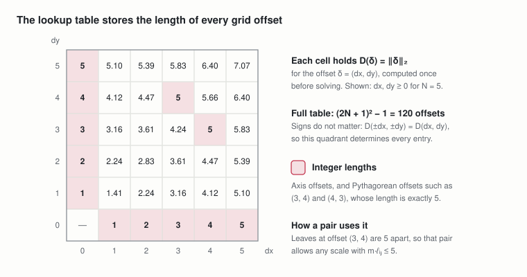

# TreeMaker foundations: grid offsets

Nov 2, 2026 · @Andrew Behn

This document defines the offsets two grid points can have, the table of their lengths and the finite set of scales a grid layout can have. The base spec (Pure MILP), the symmetry-breaking spec, the lattice-hull spec, the optimized spec and the scalable spec use them. It builds on the tree, the grid and the path lengths of the [sheet spec](https://claude.ai/artifact/Wkj6BjP3fGNPKLv3p3zW3C), and keeps its running example: the four-leaf tree on a 9 × 9 grid.

**Labels.** D:n numbers the shared definitions of this document in order of appearance. Other documents cite them with the short name offsets, as in offsets D:2. Labels of the sheet spec are written sheet P:3 or sheet D:1.

## 1. Notation

Notation follows the sheet spec (sheet Section 1). D(δ) is the table entry of an offset δ = (δ₁, δ₂), and δ₁ and δ₂ are its two integer components.

**Pair offsets.** The offset of a leaf pair is the difference of the two leaves' grid points uᵢ (sheet Section 3), so it depends on where the leaves are placed. Each pair gets a fixed order i < j so that its offset has a sign.

```math
\delta_{ij} = u_i - u_j \in \mathbb{Z}^2 \qquad \forall\, \{i, j\} \in \mathcal{P},\ i < j
```

## 2. Shared definitions

Every quantity below depends only on the grid size N and the path lengths, and is computed before anything is solved.

**D:1 Candidate offsets.** The set Δ\_N lists every value a pair offset can take on the N × N grid, fixed before anything is placed: both coordinates of two grid points lie in {0, …, N}, so their difference lies in {−N, …, N}², and the zero offset is left out because two leaves cannot share a grid point at a positive scale.

```math
\Delta_N = \{-N, \dots, N\}^2 \setminus \{(0, 0)\}, \qquad |\Delta_N| = (2N + 1)^2 - 1, \qquad \delta_{ij} \in \Delta_N \ \ \forall\, \{i, j\} \in \mathcal{P}
```

Used in: D:2 and D:3; base Section 3, Section 4 and Section 7, symmetry-breaking Section 5, lattice-hull Section 1, optimized Section 4.2, scalable Section 11.1, hulls Section 2 and Section 5. For N = 9 there are 360 candidate offsets.

**D:2 Offset distance lookup table.** The table D gives the Euclidean length of every candidate offset; it depends only on N, not on the tree, so it is computed once per grid size and shared by every leaf pair.

```math
D : \Delta_N \to \mathbb{R}_{> 0}, \qquad D(\delta) = \|\delta\|_2 = \sqrt{\delta_1^2 + \delta_2^2}, \qquad D(\pm\delta_1, \pm\delta_2) = D(\delta_1, \delta_2)
```

Used in: D:3; base C:4, symmetry-breaking Section 5.



*offset distance lookup table · quadrant for N = 5*
The table replaces the nonconvex function ‖uᵢ − uⱼ‖₂ by one value per possible offset, so a model that selects an offset reads its length as a linear expression. Signs do not matter, so one quadrant fixes every entry, and D takes at most (N + 1)(N + 2)/2 distinct values, one per squared length.

**D:3 Candidate scales.** Every table length divided by a pair's path length (sheet D:1), up to the scale bound m̄ of sheet D:3, sorted increasingly; every grid layout's scale is one of them.

```math
\mathcal{C} = \left\{ \frac{D(\delta)}{\ell_{ij}} : \delta \in \Delta_N,\ \{i, j\} \in \mathcal{P} \right\} \cap [0, \bar{m}] = \{\, c_1 < c_2 < \dots < c_K \,\}, \qquad m^{*} \in \mathcal{C}
```

Used in: lattice-hull P:1, Section 7, Section 8.1, Section 8.2 and Section 9, optimized Section 4.1 and Section 4.2, scalable Section 2, A:3, A:4 and Section 12.

The scale of a layout is the smallest ratio in sheet D:2, and the pair that attains it has a table length D(δ) as its distance, so the scale equals D(δ)/ℓᵢⱼ for that pair; at the optimum m\* ≤ m̄ as well. So #𝒞 grows like N² times the number of distinct path lengths, and a bisection over 𝒞 needs at most ⌈log₂ K⌉ tests. For the running example, the 9 × 9 grid has 50 distinct squared lengths and the tree 6 path lengths, giving 195 candidates up to m̄ ≈ 1.273; m\* = 1.054 = √90 / 9 is the one set by pair 2–4.
