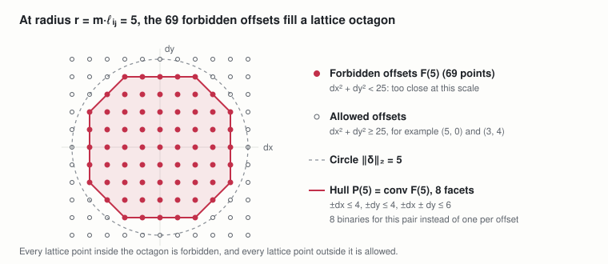
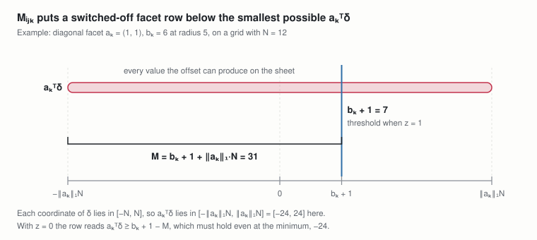
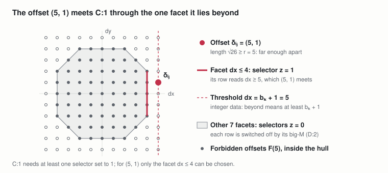
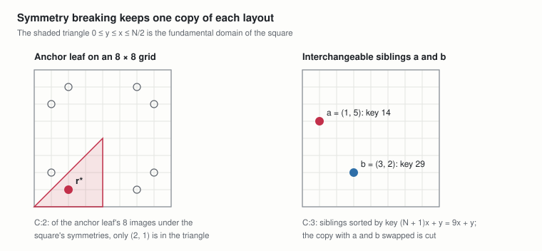
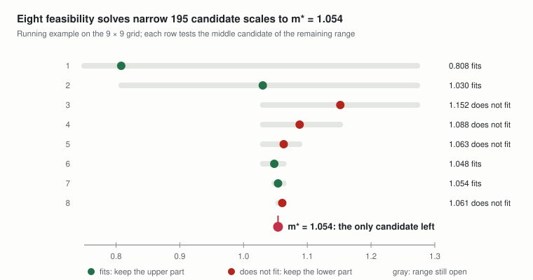
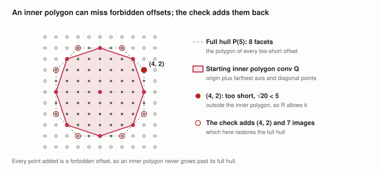
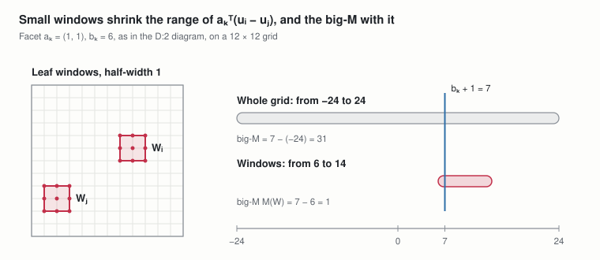
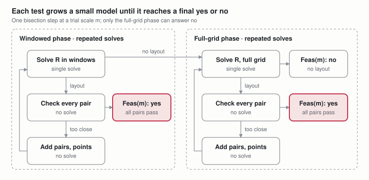

# Optimized MILP TreeMaker

Oct 25, 2026 · @Andrew Behn

An exact, faster formulation of [Pure MILP TreeMaker](https://claude.ai/artifact/1L1y2Ey5CzUT8AzfJ2sev4). It solves the same problem, TreeMaker's scale optimization with every leaf on a grid point of a fixed N × N sheet, and finds the same optimum. It reaches it with much smaller models, and should be read after the base document.

**What changes.** The base model gives every leaf pair one binary per possible offset, (2N + 1)² − 1 per pair, and reads distances from a lookup table. Four optimizations shrink that. Each has its own section and builds on the model the earlier ones produce:

1. **Lattice hulls at a fixed scale (Section 3).** At a fixed scale, a pair only needs to know whether its offset is too short. The too-short offsets fill a lattice polygon, so one binary per side of the polygon, a few dozen at most, replaces one per offset.
2. **Symmetry breaking (Section 4).** Rotating or reflecting the sheet, or swapping interchangeable leaves, gives an equivalent layout. Two constraints keep one copy of each.
3. **Scale search (Section 5).** The optimal scale is one of finitely many candidate values, so bisecting over them with the fixed-scale model finds m\*.
4. **Incremental solving (Section 6).** Most pairs never bind (reach exactly their minimum distance), so each fixed-scale model is built up from a small one, adding only what a solution violates.

Section 7 puts the four together and compares model sizes. Nothing in this document loses a layout the base model allows: every change is an exact reformulation, a valid tightening (a constraint that removes only layouts with an equivalent copy left), or, for the leaf windows of Section 6, a restriction that is always backed by a full-grid solve before any answer of "no".

**How each optimization is written.** Sections 3 and 4 change the model itself, so they follow the base document's order and state only what is added, replaced, or kept: sets, parameters, definitions, variables, constraints, and the resulting model. Sections 5 and 6 are mainly procedures: they state their definitions and models in the same order, then the procedure. Every section ends with why it is exact and what it gains.

**Labels.** P:n, D:n, and C:n are numbered through this whole document in order of first appearance. Labels from the base document are written base P:n, base D:n, and base C:n. A section's shared definitions, used in more than one place, are listed under its Shared definitions heading. A definition used in one place only is given at that place: D:5 sits beside C:5.

## 1. Notation

Notation follows Pure MILP TreeMaker (base Section 2). The symbols and terms below are added here.

| Symbol or term | Meaning |
| --- | --- |
| X ∪ Y | Union: the elements in X or Y |
| aᵀδ | Inner product a₁δ₁ + a₂δ₂ of two plane vectors |
| ‖a‖₁ | L1 norm \|a₁\| + \|a₂\| |
| conv(X) | Convex hull: the smallest convex set containing X |
| Lattice polygon | A polygon whose vertices are all points of ℤ² |
| Facet | One side of a convex polygon, written as a half-plane aᵀδ ≤ b that the polygon satisfies, with equality along that side |
| Crossable facet | A facet that at least one grid offset in {−N, …, N}² lies strictly beyond (D:1) |
| gcd(p, q) | Greatest common divisor of two integers |
| Dihedral group of the square | The 8 symmetries of a square: 4 rotations (0°, 90°, 180°, 270°) and 4 reflections |
| Fundamental domain | A region holding exactly one image of every point under those 8 symmetries; here the triangle 0 ≤ y ≤ x ≤ N/2 |
| Big-M constant | A constant large enough that a constraint multiplied by (1 − binary) is redundant when the binary is 0 |
| Tight (binding) pair | A leaf pair whose distance equals its required minimum, ‖uᵢ − uⱼ‖₂ = m·ℓᵢⱼ. Tight pairs limit the scale: any larger scale would put them too close. TreeMaker calls their paths at the optimum active paths. |
| Feasible, infeasible | A layout is feasible when it satisfies every constraint of a model. A model is feasible when it has such a layout and infeasible when it has none; a scale m is feasible when Feas(m) is. |
| Trial scale | A fixed value of the scale m that one feasibility model tests (P:1) |
| Bisection | Repeatedly halving a sorted range by testing its middle value |
| Relaxation, restriction | A relaxation of a model drops requirements, so it keeps every layout of the model and may admit more. A restriction drops options, so it keeps only some of them (Section 6.1). |
| LP relaxation | The model with its integer requirements dropped, which MILP solvers solve to get bounds (base Section 10) |
| Valid tightening | An added constraint that removes only layouts with an equivalent copy that remains, so the optimum is unchanged |
| Contact graph | For a set of non-overlapping circles, the graph with one edge per pair of touching circles |

**Solver-use labels.** The procedures of Sections 5–7 mark each step with how it uses the solver:

- **No solve:** arithmetic or precomputation only; no MILP is solved.
- **Single solve:** one MILP model, built once and solved once.
- **Repeated solves:** a loop whose passes each contain at least one single solve. The number of passes is not fixed in advance.

## 2. Starting point: the base model

Every optimization starts from the base model of Pure MILP TreeMaker (base Sections 3–8). Its components, and what this document does with each:

| Component | Base model | In this document |
| --- | --- | --- |
| Sets | Leaves L, leaf pairs 𝒫, grid G\_N, pair offsets δᵢⱼ, candidate offsets Δ\_N (base Section 3) | Kept; Section 4 adds the interchangeable siblings 𝒯 |
| Parameters | Tree, edge lengths, grid size (base P:1–P:3) | Kept; Sections 3, 4, and 6 add P:1–P:5 |
| Definitions | Path lengths ℓᵢⱼ, lookup table D, scale bound m̄ (base D:1–D:3) | Kept; D now only lists the candidate scales (D:3) |
| Variables | Scale m, leaf coordinates uᵢ, offset selectors w | m becomes the trial scale P:1; uᵢ kept; w replaced by facet selectors z (Section 3) |
| Constraints | Leaves on grid points (base C:1); offset selection, offset linking, and spacing through the lookup table (base C:2–C:4) | Base C:1 kept until Section 6; base C:2–C:4 replaced by C:1 |
| Objective | Maximize m | Kept, reached by the scale search of Section 5 |

```math
L,\ \mathcal{P},\ G_N = \{0, 1, \dots, N\}^2,\ \delta_{ij} = u_i - u_j \in \Delta_N = \{-N, \dots, N\}^2 \setminus \{(0, 0)\}
```

## 3. Lattice hulls at a fixed scale

Fix the scale for each solve, and replace each pair's offset selectors by a test of whether its offset is too short. This changes the base model's variables and spacing constraints; everything else is kept.

### 3.1 Parameters

**P:1 Trial scale.** The scale, fixed for one solve instead of being a variable. Section 5 chooses its values.

```math
m > 0
```

### 3.2 Shared definitions

**D:1 Forbidden offsets and their lattice hull.** For a radius r: the grid offsets shorter than r, their convex hull P(r), and its facets K(r), written with integer coefficients. Facets that no offset in {−N, …, N}² can cross are left out of K(r). A pair uses the radius r = m·ℓᵢⱼ.

```math
F(r) = \{\, \delta \in \{-N, \dots, N\}^2 : \|\delta\|_2 < r \,\}, \qquad P(r) = \operatorname{conv} F(r) = \{\, \delta \in \mathbb{R}^2 : a_k^{\top} \delta \leq b_k \ \ \forall\, k \in K(r) \,\}, \qquad a_k \in \mathbb{Z}^2,\ \gcd(a_{k1}, a_{k2}) = 1,\ b_k \in \mathbb{Z}
```

Used in: D:2, the facet selectors z, and constraint C:1.



*forbidden offsets at radius 5 · lattice octagon and its 8 facets*
**D:2 Facet big-M.** For each pair and facet, the constant that switches that facet's row of C:1 off when its selector is 0.

```math
M_{ijk} = b_k + 1 + \|a_k\|_1\, N
```

Used in: constraint C:1.



*facet big-M · range of aₖᵀδ against the threshold*
### 3.3 Variables

Kept: the leaf coordinates of base Section 6. Removed: the scale m, which is now the trial scale P:1, and the offset selectors w. Added: the facet selectors.

```math
x_i,\ y_i \in \mathbb{Z} \cap [0, N], \qquad u_i = (x_i, y_i) \qquad \forall\, i \in L
```

**Facet selectors.** For each leaf pair, one binary per facet of its hull at the trial scale; 1 means the pair lies beyond that facet.

```math
z_{ijk} \in \{0, 1\} \qquad \forall\, \{i, j\} \in \mathcal{P},\ k \in K(m\, \ell_{ij})
```

### 3.4 Constraints

Kept: base C:1, leaves on grid points. Replaced: base C:2–C:4 (offset selection, offset linking, and spacing through the lookup table), by C:1.

**C:1 Spacing through the hull.** Each pair's offset lies strictly outside its hull at the trial scale, beyond at least one facet.

```math
\begin{aligned}
&a_k^{\top} (u_i - u_j) \geq b_k + 1 - M_{ijk} (1 - z_{ijk}) && \forall\, k \in K(m\, \ell_{ij}) \\
&\textstyle\sum_{k \in K(m\, \ell_{ij})} z_{ijk} \geq 1
\end{aligned}
\qquad \forall\, \{i, j\} \in \mathcal{P}
```



*C:1 · an offset beyond one facet of its hull at radius 5*
A pair at radius 5 with offset (5, 1) lies beyond exactly one facet, so that facet's selector is the only one that can be 1.

### 3.5 The model

The hull model H(m) is base C:1 and C:1 over the leaf coordinates and facet selectors, with no objective. It asks whether a layout exists at the trial scale m.

```math
\mathrm{H}(m): \quad \text{find } u, z \ \text{ satisfying base C:1 and C:1}
```

### 3.6 Why it is exact

- **The hull holds exactly the too-short offsets.** P(r) is the convex hull of points inside the circle of radius r, so it lies inside that circle, and the lattice points it contains are exactly F(r). A grid offset is therefore too short exactly when it lies in P(r).
- **The +1 shift is exact.** The facet data are integers, so for a lattice offset, lying strictly beyond facet k is the same as reaching bₖ + 1.
- **The big-M is large enough.** Both coordinates of an offset lie in \[−N, N\], so aₖᵀδ ≥ −‖aₖ‖₁N. A row whose selector is 0 then always holds.
- **Leaving out uncrossable facets loses nothing,** because no offset on the sheet could use them.

```math
\delta \in \{-N, \dots, N\}^2: \qquad \delta \notin P(r) \iff \|\delta\|_2 \geq r, \qquad a_k^{\top} \delta > b_k \iff a_k^{\top} \delta \geq b_k + 1, \qquad -\|a_k\|_1 N \leq a_k^{\top} \delta \leq \|a_k\|_1 N
```

Together, C:1 is TreeMaker's pair condition at the trial scale, the same condition base C:2–C:4 enforce through the lookup table. So H(m) has a solution exactly when the base model has a layout at scale m or more.

```math
\text{C:1} \iff \|u_i - u_j\|_2 \geq m\, \ell_{ij} \qquad \forall\, \{i, j\} \in \mathcal{P}
```

### 3.7 What it gains, and what it costs

**Fewer binaries.** Each pair needs one binary per crossable facet instead of one per candidate offset. At the running example's optimum on the 9 × 9 grid, the six pairs' hulls have 72 crossable facets in total, against 2,160 offset selectors in the base model.

**Few distinct hulls.** F(r) depends on r only through which integer squared lengths dx² + dy² fall below r². There are finitely many distinct hulls, and each is computed once and reused for every pair and trial scale that needs it.

**The cost: the scale is fixed.** The base model's selectors read the exact length of whichever offset a pair takes, so m could stay a variable and one solve found m\*. The hull test only says whether an offset is too short at one radius, and P(r) changes with r = m·ℓᵢⱼ, so the test exists only once m is fixed. If m stayed a variable, each pair would need a different polygon for every value m could take, which brings back much of the size the hulls remove. H(m) therefore answers a yes-or-no question at one scale, and Section 5 searches over scales: several small solves replace one large one.

**The cost: big-M constants.** The base model needs none, because base C:4 reads distances directly. D:2 is the price of the much smaller selector set, and it keeps the LP relaxation weak (Section 7.2).

## 4. Symmetry breaking

Rotating or reflecting the square sheet, or swapping two interchangeable leaves, turns a layout into an equally good one, and the solver would otherwise search every copy. This section adds two constraints that keep one copy of each, and changes nothing else.

### 4.1 Sets

**Interchangeable siblings.** Ordered pairs (a, b) of leaves with the same parent and equal edge length.

```math
\mathcal{T} \subseteq L \times L
```

### 4.2 Parameters

**P:2 Anchor leaf.** A leaf that is in no pair of 𝒯.

```math
r^{\ast} \in L
```

### 4.3 Constraints

Kept: base C:1 and C:1. Added: C:2 and C:3.

**C:2 Anchor in the fundamental domain.** The anchor leaf lies in the triangle 0 ≤ y ≤ x ≤ N/2.

```math
2 x_{r^\ast} \leq N, \qquad 2 y_{r^\ast} \leq N, \qquad y_{r^\ast} \leq x_{r^\ast}
```

**C:3 Sibling order.** Interchangeable siblings appear in lexicographic order of their coordinates.

```math
(N + 1)\, x_a + y_a \leq (N + 1)\, x_b + y_b \qquad \forall\, (a, b) \in \mathcal{T}
```



*C:2 and C:3 · anchor in the fundamental domain, siblings in order*
On an 8 × 8 grid, an anchor leaf at (6, 1) has 8 images and only (2, 1) satisfies C:2; for two siblings, only the order with the smaller key first satisfies C:3.

### 4.4 The model

The feasibility model Feas(m) is H(m) with C:2 and C:3 added: base C:1 and C:1–C:3, with no objective.

```math
\mathrm{Feas}(m): \quad \text{find } u, z \ \text{ satisfying base C:1 and C:1–C:3}
```

### 4.5 Why it is exact

The sheet's 8 symmetries map grid points to grid points and keep every distance, so they map each layout of H(m) to another layout of H(m). Swapping two interchangeable siblings does the same, because they have the same path length to every other leaf. Any layout can therefore be rotated or reflected to put the anchor in the fundamental domain, and then have its siblings sorted, which does not move the anchor because the anchor is in no sibling pair. So Feas(m) has a solution exactly when H(m) does, and C:2 and C:3 are a valid tightening.

### 4.6 What it gains

Without C:2 and C:3, each layout appears up to 8 times from the sheet's symmetries, and g! times more for each group of g interchangeable siblings, and branch-and-bound (the solver's search, base Section 10) can explore every copy. The two constraints remove those copies. Translations of a layout with slack (room to spare at the sheet's edges) remain.

## 5. Scale search

Feas(m) answers a yes-or-no question at one scale. This section recovers the base model's objective, the largest scale, by testing a short sequence of candidate scales. It adds one definition, the objective, and a procedure; the model is Feas(m), unchanged.

### 5.1 Shared definitions

**D:3 Candidate scales.** Every lookup-table distance divided by a pair's path length, up to the scale bound m̄ of base D:3.

```math
\mathcal{C} = \left\{ \frac{D(\delta)}{\ell_{ij}} : \delta \in \Delta_N,\ \{i, j\} \in \mathcal{P} \right\} \cap [0, \bar{m}]
```

Used in: the objective and the bisection below.



*bisection over candidate scales · running example, 9 × 9 grid*
### 5.2 Objective

The base model's objective, maximize the scale, restated over the candidates:

```math
m^{*} = \max \{\, m \in \mathcal{C} : \mathrm{Feas}(m) \text{ has a solution} \,\}
```

### 5.3 Procedure: bisection (repeated solves)

Each test decides whether Feas(m) has a solution, either by solving Feas(m) once (single solve) or by the incremental procedure of Section 6 (repeated solves).

1. Sort the candidates: c₁ < c₂ < … < c\_K. No solve.
2. Set lo to the index of any candidate known to be feasible, and hi = K. The rounded TreeMaker layout of base Section 9 gives such a candidate, at least N·m\_TM − √2/ℓ\_min; without it, use lo = 1. No solve.
3. While lo < hi: test the middle candidate c\_mid, with mid = ⌈(lo + hi)/2⌉. If Feas(c\_mid) has a solution, set lo = mid and keep the layout; otherwise set hi = mid − 1. One test per pass.
4. Return m\* = c\_lo and the last layout found, which is optimal for the base model. No solve.

### 5.4 Why it is exact

- **m* is a candidate.*\* At an optimal layout some pair is tight (exactly at its minimum distance); otherwise every pair would have room to spare and the same layout would work at a slightly larger scale. That pair's distance is a lookup-table value D(δ) and equals m\*·ℓᵢⱼ, so m\* = D(δ)/ℓᵢⱼ, and m\* ≤ m̄ by base D:3.
- **Feasibility is monotone in the scale.** A layout that works at scale m also works at every smaller scale, because each pair's required distance only shrinks. So the sorted candidates split into a feasible lower part and an infeasible upper part, and bisection finds the boundary, m\*.

```math
m^{*} \in \mathcal{C}, \qquad \mathrm{Feas}(m) \text{ has a solution and } m' \leq m \ \Longrightarrow\ \mathrm{Feas}(m') \text{ has a solution}
```

### 5.5 What it gains, and what it costs

**Few tests.** D takes at most (N + 1)(N + 2)/2 distinct values, one per squared length, and there is one path length per pair, so |𝒞| grows like N² times the number of distinct path lengths, and bisection needs at most ⌈log₂|𝒞|⌉ tests. For the running example, the 9 × 9 grid has 50 distinct squared lengths and the tree 6 path lengths, giving 195 candidates up to m̄ ≈ 1.273; eight tests find m\* = 1.054.

**Warm starts.** Each feasible layout can be passed to the next solve as a starting solution.

**The expensive tests.** The tests that prove infeasibility (that no layout exists), just above m\*, are usually the hardest. Section 6 makes each test smaller.

## 6. Incremental solving of each feasibility model

Feas(m) carries every leaf pair, every crossable facet of each pair's hull, and every leaf free on the whole grid. This section decides the same question with a loop of smaller models R, which grow only where a layout breaks a requirement. It uses three devices: pair generation, facet generation, and leaf windows. The parts below give R in the model-spec order, then the procedure.

### 6.1 When a smaller model gives a final answer

A smaller model can stand in for Feas(m) in one of two ways, and each settles only one kind of answer.

- **A relaxation** drops requirements, so every layout of Feas(m) is also a layout of it. If a relaxation has no layout, Feas(m) has none: its "no" is final.
- **A restriction** drops options, so every layout of it is also a layout of Feas(m). If a restriction has a layout, so does Feas(m): its "yes" is final.

Pair generation and facet generation are relaxations, and leaf windows are a restriction. A model that uses windows together with either relaxation is neither, so its "no" settles nothing. The procedure therefore uses windows only to find layouts quickly, and decides every "no" without them.

### 6.2 Parameters

R has three inputs, which the procedure sets and grows between solves.

**P:3 Active pairs.** The pairs whose spacing rows are in the model. All other pairs are left out and checked after the solve.

```math
A \subseteq \mathcal{P}
```

**P:4 Inner polygon points.** For each active pair, a set of its forbidden offsets.

```math
Q_{ij} \subseteq F(m\, \ell_{ij}) \qquad \forall\, \{i, j\} \in A
```

**P:5 Leaf windows.** For each leaf, a box of the grid with integer bounds.

```math
W_i = [\underline{x}_i, \overline{x}_i] \times [\underline{y}_i, \overline{y}_i] \subseteq [0, N]^2 \qquad \forall\, i \in L
```

### 6.3 Shared definitions

**D:4 Inner polygon.** The lattice hull of an active pair's points Qᵢⱼ, with facets K(Qᵢⱼ) written with integer data as in D:1.

```math
\operatorname{conv} Q_{ij} = \{\, \delta : a_k^{\top} \delta \leq b_k \ \ \forall\, k \in K(Q_{ij}) \,\} \subseteq P(m\, \ell_{ij})
```

Used in: the facet selectors and C:5.



*D:4 · starting inner polygon at radius 5 and an offset it misses*
The starting inner polygon misses the forbidden offset (4, 2). If R picks it, the check adds it and its images, which at radius 5 restores the full hull.

### 6.4 Variables

Kept: the leaf coordinates. Changed: facet selectors exist only for active pairs, one per facet of the inner polygon.

```math
z_{ijk} \in \{0, 1\} \qquad \forall\, \{i, j\} \in A,\ k \in K(Q_{ij})
```

### 6.5 Constraints

Kept: C:2 and C:3. Replaced: base C:1 by C:4, and C:1 by C:5.

**C:4 Leaves in their windows.** Each leaf lies on a grid point inside its window.

```math
u_i \in W_i \cap G_N \qquad \forall\, i \in L
```

**D:5 Window big-M.** The facet big-M of D:2, computed over the windows instead of the whole grid, coordinate by coordinate from the window bounds. A facet that cannot be crossed inside the windows is left out.

```math
M_{ijk}(W) = b_k + 1 - \min_{u_i \in W_i,\ u_j \in W_j} a_k^{\top} (u_i - u_j)
```

Used in: C:5.



*D:5 and C:4 · leaf windows and the window big-M*
With both leaves confined to 3 × 3 windows, the facet row's left side ranges over 6 to 14 instead of −24 to 24, and the big-M falls from 31 to 1.

**C:5 Spacing through the inner polygons.** Each active pair's offset lies strictly outside its inner polygon, beyond at least one facet.

```math
\begin{aligned}
&a_k^{\top} (u_i - u_j) \geq b_k + 1 - M_{ijk}(W)\, (1 - z_{ijk}) && \forall\, k \in K(Q_{ij}) \\
&\textstyle\sum_{k \in K(Q_{ij})} z_{ijk} \geq 1
\end{aligned}
\qquad \forall\, \{i, j\} \in A
```

### 6.6 The model (single solve)

The restricted model R(m; A, Q, W) is C:2–C:5, with no objective. Each round of the procedure solves it once.

```math
\mathrm{R}(m; A, Q, W): \quad \text{find } u, z \ \text{ satisfying C:2–C:5}
```

Two special cases matter. With every pair active, full polygons (Qᵢⱼ = F(m·ℓᵢⱼ)), and full windows (Wᵢ = \[0, N\]²), R is exactly Feas(m). With full windows alone, R is a relaxation of Feas(m).

### 6.7 Starting choices (no solve)

- **Active pairs:** the pairs that are tight or nearly tight (at, or close to, their minimum distance) in the window center layout of 6.9, plus every pair of leaves that share a parent.
- **Inner polygon points:** the origin and the points of F(m·ℓᵢⱼ) farthest along the four axis and four diagonal directions, which gives at most 8 facets. Setting Qᵢⱼ = F(m·ℓᵢⱼ) gives the full hull back and turns facet generation off; with only a few dozen facets per full hull, facet generation saves less than the other two devices.
- **Windows:** a box of half-width h around each leaf of the window center layout, clipped to the grid. h is a tuning choice; it changes how fast a step runs, not its answer.

### 6.8 The generation loop (repeated solves)

The loop takes a trial scale m, a set of windows, and the current A and Q. Each pass does the following.

1. **Solve R(m; A, Q, W).** Single solve.
2. **If R has no layout,** stop. With full windows, Feas(m) has no layout either, and the step's answer is a final "no". With smaller windows, the phase has failed and says nothing about Feas(m).
3. **Check the layout.** No solve. For every pair in 𝒫, compare ‖δᵢⱼ‖₂ with m·ℓᵢⱼ. For each pair that is too close: if the pair is not active, add it to A, with its starting points plus the offending offset δᵢⱼ; if it is active, its inner polygon was too small, so add δᵢⱼ to Qᵢⱼ, together with its images under the 8 symmetries of the square.
4. **If no pair was too close,** stop. The layout satisfies Feas(m), and the step's answer is a final "yes". Otherwise return to 1.

### 6.9 One bisection step (repeated solves)

A step at a trial scale m runs the generation loop in up to two phases.

1. **Windowed phase.** Repeated solves. Take as the window center layout the last feasible layout found, or, at the first step, the rounded TreeMaker layout of base Section 9. Map it into the form C:2 and C:3 require: apply the symmetry of the square that puts the anchor leaf in the fundamental domain, and swap any interchangeable siblings that are out of order. Set the windows around it and run the generation loop. A "yes" is final. If R has no layout, go to phase 2.
2. **Full-grid phase.** Repeated solves, run only when the windowed phase fails. Run the generation loop again with full windows, starting from the A and Q that the windowed phase built. Its "yes" or "no" is final.



*one bisection step · windowed phase, then full-grid phase*
Each phase loops through a single solve, a check, and additions. The windowed phase can only end in "yes" or hand over; the full-grid phase ends in a final "yes" or "no".

### 6.10 What carries from one step to the next (no solve)

The bisection moves up after a "yes" and down after a "no". The loop's state carries over by these rules:

| Item | To a higher trial scale | To a lower trial scale m′ |
| --- | --- | --- |
| Active pairs A | Kept | Kept |
| Inner polygon points Q | Kept | Kept only while ‖δ‖₂ < m′·ℓᵢⱼ; then the new scale's starting points are added |
| Window center layout | The last feasible layout | The last feasible layout |

### 6.11 Why it is exact

- **Full-window models settle "no".** With full windows, R keeps only some pairs, and each inner polygon lies inside its full hull, so being outside it is a weaker requirement than C:1. R is then a relaxation, and if it has no layout, neither does Feas(m).
- **Checked layouts settle "yes".** The check tests every pair against its true minimum distance, and every layout of R has its leaves on grid points and satisfies C:2 and C:3. A layout that passes the check therefore satisfies Feas(m), whatever windows were used.
- **The window big-M is large enough.** It is computed from the smallest value aₖᵀ(uᵢ − uⱼ) can take inside the windows, so a row whose selector is 0 always holds there. With full windows it equals D:2.
- **The added points are forbidden.** A too-short offset lies in F(m·ℓᵢⱼ), and so do its 8 images, because F depends only on length.
- **The loop ends.** Every pass that does not stop adds at least one pair or one lattice point, and there are finitely many of both. In the worst case R grows into Feas(m).
- **The carried state stays valid.** Any subset of the real pairs gives a relaxation at every scale, so A carries both ways. The forbidden sets are nested, so points carry upward; at a lower scale some points may be long enough, and keeping them would forbid valid offsets, so they are dropped.
- **A badly placed window costs time, not exactness.** Windows around a layout that breaks C:2 or C:3 can make the windowed phase fail even though a mirror image would fit. The full-grid phase catches that, and mapping the center layout first avoids it.

```math
m < m' \ \Longrightarrow\ F(m\, \ell_{ij}) \subseteq F(m'\, \ell_{ij})
```

### 6.12 What it gains, and what it costs

Each round has one binary per facet of each active pair's inner polygon, instead of one per crossable facet of every pair's full hull.

```math
\underbrace{\textstyle\sum_{\{i, j\} \in A} |K(Q_{ij})|}_{\text{one round of R}} \quad \text{instead of} \quad \underbrace{\textstyle\sum_{\{i, j\} \in \mathcal{P}} |K(m\, \ell_{ij})|}_{\mathrm{Feas}(m)}
```

Binding pairs (pairs exactly at their minimum distance) in TreeMaker layouts tend to form a sparse, roughly planar pattern, like the contact graph of a circle packing, which has at most 3n − 6 edges. If the active set stays near that size, a 50-leaf tree on a 32 × 32 grid needs about 150 active pairs with at most 48 facets each: about 7,200 binaries per round, against at most 58,800 for Feas(m) and 5,174,400 for the base model. Smaller windows also give smaller big-Ms and a tighter LP relaxation.

The cost is more rounds per step. Their number has no useful bound in advance; it depends on how well the starting set guesses the binding pairs. The running example, with only six pairs, is too small to gain from pair generation.

## 7. The combined algorithm and model size

### 7.1 The full algorithm

| Level | Step | Solver use | Where |
| --- | --- | --- | --- |
| 0 | Setup: candidate scales, hulls, and the rounded TreeMaker layout | No solve (plus one continuous TreeMaker solve, which is not a MILP) | D:1, D:3, base Section 9 |
| 1 | Bisection over candidate scales | Repeated solves: at most ⌈log₂ K⌉ tests | 5.3 |
| 2 | One test at a trial scale m | Repeated solves: a windowed phase, then a full-grid phase only if needed | 6.9 |
| 3 | One phase: the generation loop | Repeated solves: one round per pass | 6.8 |
| 4 | One round: the restricted model R | Single solve | 6.6 |
| 5 | The check after each round | No solve | 6.8 |

Without Section 6, levels 2–5 collapse into one single solve of Feas(m) per test.

### 7.2 Model size compared with the base model

The base model solves one large MILP; this model solves a short sequence of small ones. Both reach the same optimum. The counts below are for the full Feas(m); Section 6.12 gives the smaller sizes of each round of the generation loop.

**Binaries per pair.** The base model needs one selector per candidate offset. This model needs one per crossable facet of the pair's hull, and a hull's facet count grows only like r^(2/3), with r ≤ √2·N on the sheet.

| Grid | Base: selectors per pair | This model: facets per pair, worst case over all scales |
| --- | --- | --- |
| N = 9 | 360 | 20 |
| N = 16 | 1,088 | 28 |
| N = 32 | 4,224 | 48 |

**Whole models.** Counts below are binaries. For this model they are per solve, with the number of solves bounded by ⌈log₂|𝒞|⌉.

| Instance | Base model, one solve | This model, per solve | Solves |
| --- | --- | --- | --- |
| Running example, 4 leaves, N = 9 | 2,160 | 56 to 80 | 8 |
| 20 leaves, N = 32 | 802,560 | at most 9,120 | at most 17 |
| 50 leaves, N = 32 | 5,174,400 | at most 58,800 | at most 20 |

Even summed over all eight solves, the running example uses 564 binaries, a quarter of the base model's 2,160, and each solve is a far smaller search, which matters more because MILP effort grows much faster than linearly with size.

**Rows and nonzeros.** The base model has four rows per pair, but each touches all (2N + 1)² − 1 selectors of the pair. This model has one row per facet plus one, and each facet row touches at most five variables (four coordinates and its selector). Nonzeros per pair fall from about 4(2N + 1)² to at most 6|K(m·ℓᵢⱼ)|.

**How the sizes scale.**

```math
\underbrace{O(n^2 N^2)}_{\text{base: one model}}
\quad \longrightarrow \quad
\underbrace{O\big(n^2 N^{2/3}\big)}_{\text{per feasibility model}} \ \times \ \underbrace{O\big(\log (N^2 n^2)\big)}_{\text{solves}}
```

**What does not improve.** The facet rows of C:1 and C:5 use big-M constants, so the LP relaxation is still weak in the sense of base Section 10: averaging two facet choices can place leaves too close in the relaxation. The gains come from a much smaller search per solve and from the symmetry breaking of C:2 and C:3, not from a tighter bound.
