# Pure MILP TreeMaker

Oct 25, 2026 · @Andrew Behn

The goal of this document is a pure mixed-integer linear program (MILP) for TreeMaker's scale optimization: the same objective and the same spacing requirement, with every constraint linear. The fixed grid is how it gets there. Restricting the leaves to grid points turns TreeMaker's continuous positions and nonlinear distance constraints into a selection problem: each leaf selects a grid point, each pair selects the offset between its two leaves, and the distance is read from a precomputed lookup table. The grid is the only approximation, and it vanishes as the grid gets finer (Section 9). This is the starting point for [Optimized MILP TreeMaker](https://claude.ai/artifact/LxhWqnKYWWuTrdmJ3hrKdq).

## 1. From TreeMaker to a pure MILP

**TreeMaker's scale optimization.** Lang's TreeMaker places the leaves of a weighted tree in the unit square and maximizes the scale m, the paper length per unit of tree length. Folding never stretches paper, so two flap tips must start at least as far apart on the sheet as their tree path length, times the scale.

```math
\max_{m,\ u} \ m \qquad \text{subject to} \qquad \|u_i - u_j\|_2 \geq m\, \ell_{ij} \ \ \forall\, \{i, j\} \in \mathcal{P}, \qquad u_i \in [0, 1]^2 \ \ \forall\, i \in L
```

**The pure MILP version.** This model keeps TreeMaker's objective and pair constraints and makes them linear. The sheet becomes an N × N grid with N chosen in advance, and **every leaf must lie on a grid point**. That turns each leaf's continuous position into a choice among grid points, and each pair's nonlinear distance into a choice among offsets whose lengths are precomputed in a lookup table. What remains is a selection problem with linear constraints, solvable by any MILP solver.

**Leaves versus internal vertices.** Only leaves are placed. Internal vertices are not variables in TreeMaker's scale optimization: their positions are derived later, when the crease pattern is built from the active paths. So this model puts no grid condition on them. Landing hinges on grid lines would be a crease-pattern requirement, which matters for styles such as box pleating but not for the scale optimization.

**Scale conversion.** TreeMaker's sheet has side 1 and this one has side N, so the two scales differ by a factor of N. As N grows, the lattice optimum approaches TreeMaker's continuous optimum.

```math
m_{\mathrm{TreeMaker}} = m / N
```

## 2. Notation

Every symbol and term not defined in Sections 3–6 is listed here.

| Symbol or term | Meaning |
| --- | --- |
| ∅ | The empty set |
| x ∈ X, X ⊆ Y | x is an element of X; X is a subset of Y |
| X \\ Y | Set difference: elements of X that are not in Y |
| X × Y | Cartesian product: all ordered pairs (x, y) with x ∈ X, y ∈ Y |
| \|X\| | Cardinality: the number of elements of X |
| {i, j} | An unordered pair, so {i, j} = {j, i} |
| ∀, ⟹ | For all; implies |
| ∑, max | Sum over, and largest value over, the indexed set |
| ℤ, ℤ≥₁ | The integers; the positive integers |
| ℝ, ℝ² | The real numbers; the real plane |
| \[a, b\] | The closed interval of reals from a to b |
| {0, 1} | The binary values; a variable in it is a binary (0/1) variable |
| {a, …, b} | The integers from a to b inclusive |
| ‖δ‖₂ | Euclidean norm √(δ₁² + δ₂²) of a plane vector |
| deg(v) | Degree: the number of edges incident to vertex v |
| path(u, v) | The edges on the unique path between u and v in a tree |
| Grid point | A point of the sheet whose two coordinates are both integers |
| Tight (binding) pair | A leaf pair whose distance equals its required minimum, ‖uᵢ − uⱼ‖₂ = m·ℓᵢⱼ. Tight pairs limit the scale: any larger scale would put them too close. TreeMaker calls their paths at the optimum active paths. |
| Slack | The amount by which a constraint is more than met; a pair with slack is farther apart than it needs to be |
| Feasible, infeasible | A layout is feasible when it satisfies every constraint of a model; a model is infeasible when no layout does |
| LP relaxation | The model with its integer requirements dropped, so binary variables may take fractional values (Section 10) |
| Branch-and-bound | The search MILP solvers use: split on variables that come out fractional, and discard branches whose LP relaxation cannot beat the best layout found (Section 10) |
| Fundamental domain | A region holding exactly one image of every point under the square's 8 symmetries (4 rotations and 4 reflections); here the triangle 0 ≤ y ≤ x ≤ N/2 |
| Interchangeable siblings | Leaves with the same parent and equal edge length, which can swap places without changing the scale |

## 3. Sets and spaces

**Leaves.** The leaves of the input tree T = (V, E) (Section 4) are its vertices of degree 1, the flap tips; n is their number.

```math
L = \{\, v \in V : \deg(v) = 1 \,\} \subseteq V, \qquad n = |L|
```

**Leaf pairs.** The set of unordered pairs of distinct leaves.

```math
\mathcal{P} = \{\, \{i, j\} : i, j \in L,\ i \neq j \,\}
```

**Integer lattice and grid.** The integer lattice ℤ² is the set of points whose two coordinates are both integers. The sheet is the square \[0, N\]², and its grid points are the lattice points it contains.

```math
\mathbb{Z}^2 = \{\, (p, q) : p, q \in \mathbb{Z} \,\}, \qquad G_N = \mathbb{Z}^2 \cap [0, N]^2 = \{0, 1, \dots, N\}^2, \qquad |G_N| = (N + 1)^2
```

**Pair offsets.** The offset of a leaf pair is the difference of the two leaves' positions uᵢ (Section 6), so it depends on where the leaves are placed. Fix an order i < j for each pair so the offset has a sign.

```math
\delta_{ij} = u_i - u_j \in \mathbb{Z}^2 \qquad \forall\, \{i, j\} \in \mathcal{P},\ i < j
```

**Candidate offsets.** The set Δ\_N lists every value a pair offset can take on the N × N grid, fixed before anything is placed. Both coordinates of two grid points lie in {0, …, N}, so their difference lies in {−N, …, N}². The zero offset is excluded because two leaves cannot share a grid point when the scale is positive. Every pair offset is a candidate offset.

```math
\Delta_N = \{-N, \dots, N\}^2 \setminus \{(0, 0)\}, \qquad |\Delta_N| = (2N + 1)^2 - 1, \qquad \delta_{ij} \in \Delta_N \ \ \forall\, \{i, j\} \in \mathcal{P}
```

## 4. Parameters

**P:1 Tree.** The input tree: a finite vertex set V and an edge set E saying which vertices are joined. E fixes the tree's connectivity, and the edge lengths below fix its proportions; together they are the weighted tree whose leaves are laid out. A tree is connected and has no cycles, so it has exactly one fewer edge than vertices.

```math
T = (V, E), \qquad E \subseteq \{\, \{u, v\} : u, v \in V,\ u \neq v \,\}, \qquad T \text{ connected}, \qquad |E| = |V| - 1
```

**P:2 Edge lengths.** Positive edge lengths in tree units. They need not be integers: the scale m converts them to grid units.

```math
\ell_e > 0 \qquad \forall\, e \in E
```

**P:3 Grid size.** The number of grid squares along each side of the sheet, fixed in advance.

```math
N \in \mathbb{Z}_{\geq 1}
```

## 5. Shared definitions

Every quantity below is computed once from the parameters before solving, and then used in more than one place among the variables, constraints, and objective. A definition used in one place only is given where it is used, keeping the numbering in order of appearance: D:4 is in Section 11.2. The diagrams use one running example: a tree with four leaves and two internal vertices u and v.

### D:1 Tree metric and path lengths

The tree metric d is the total edge length along the unique path between two vertices. Between two leaves it gives the path length ℓᵢⱼ, which the scale converts into the minimum separation of that pair. The largest path length is ℓmax.

```math
d(u, v) = \sum_{e \in \mathrm{path}(u, v)} \ell_e, \qquad \ell_{ij} = d(i, j) \ \ \forall\, \{i, j\} \in \mathcal{P}, \qquad \ell_{\max} = \max_{\{i, j\} \in \mathcal{P}} \ell_{ij}
```

Used in: the scale bound (D:3) and constraint C:4.

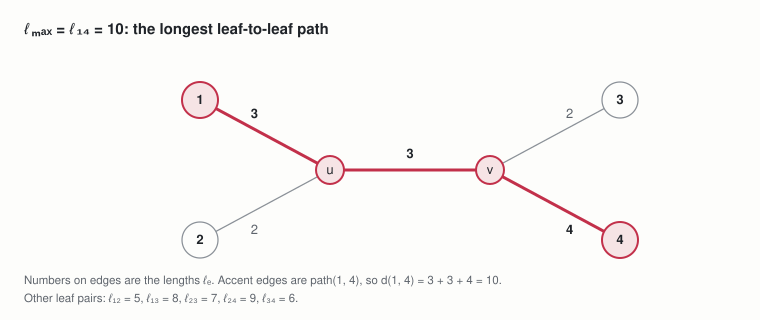

*example tree · path lengths between leaves*
In the running example, leaves 1 and 4 are farthest apart along the tree, so ℓmax = 10.

### D:2 Offset distance lookup table

The lookup table D gives the Euclidean length of every candidate offset in Δ\_N. It depends only on N, not on the tree, so it is computed once per grid size and shared by every leaf pair.

```math
D : \Delta_N \to \mathbb{R}_{> 0}, \qquad D(\delta) = \|\delta\|_2 = \sqrt{\delta_1^2 + \delta_2^2}, \qquad D(\pm\delta_1, \pm\delta_2) = D(\delta_1, \delta_2)
```

Used in: constraints C:4 to C:6 and the optimum's closed form (Section 8).

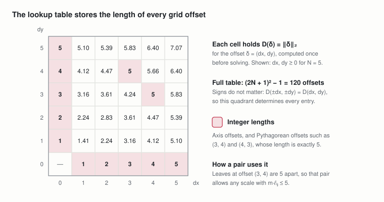

*offset distance lookup table · quadrant for N = 5*
The table replaces the nonconvex function ‖uᵢ − uⱼ‖₂ by a finite list of values, one per possible offset. Selecting an offset (Section 6) then reads its length as a linear expression.

### D:3 Scale upper bound

No two grid points are farther apart than the sheet's diagonal, √2·N, and the pair with the longest path needs m·ℓmax of that. This gives a valid upper bound on the scale.

```math
\bar{m} = \frac{\sqrt{2}\, N}{\ell_{\max}}, \qquad \text{since} \quad m\, \ell_{\max} \leq \|u_i - u_j\|_2 \leq \sqrt{2}\, N
```

Used in: the bounds on the variable m (Section 6), and Section 10.

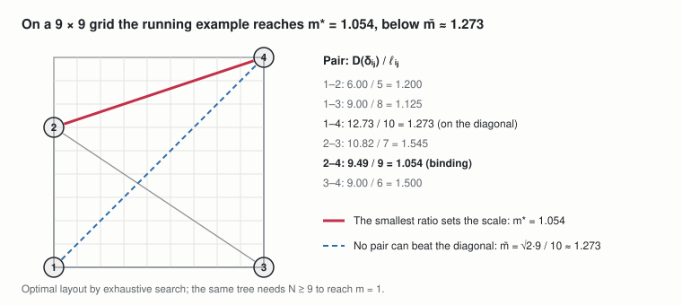

*running example on a 9 × 9 grid · binding pair and diagonal bound*
The bound is usually loose because other pairs also need room. In the running example it is reached by the diagonal pair 1–4, but pair 2–4 binds first (becomes tight, exactly at its minimum distance, at a smaller scale).

## 6. Variables

**Scale.** Grid units of paper per unit of tree length, as in TreeMaker but measured on the N × N sheet.

```math
m \in [0, \bar{m}]
```

**Leaf coordinates.** Integer coordinates, so each leaf sits on a grid point (constraint C:1).

```math
x_i,\ y_i \in \mathbb{Z} \cap [0, N], \qquad u_i = (x_i, y_i) \qquad \forall\, i \in L
```

**Offset selectors.** For each leaf pair, one binary per candidate offset; C:2 and C:3 make the selected candidate equal the pair offset δᵢⱼ.

```math
w_{ij\delta} \in \{0, 1\} \qquad \forall\, \{i, j\} \in \mathcal{P},\ \delta \in \Delta_N
```

Each pair uses |Δ\_N| = (2N + 1)² − 1 selectors: 360 for N = 9, so 2,160 for the six pairs of the running example. This size is what the optimized model removes (Section 12).

## 7. Constraints

**C:1 Leaves on grid points.** The key constraint added to TreeMaker: every leaf lies on a grid point of the fixed N × N sheet. This replaces TreeMaker's continuous unit square.

```math
u_i \in G_N \iff x_i,\ y_i \in \{0, 1, \dots, N\} \qquad \forall\, i \in L
```

**C:2 Offset selection.** Each pair selects exactly one candidate offset.

```math
\sum_{\delta \in \Delta_N} w_{ij\delta} = 1 \qquad \forall\, \{i, j\} \in \mathcal{P}
```

**C:3 Offset linking.** The selected candidate equals the pair offset δᵢⱼ = uᵢ − uⱼ, one equation per coordinate.

```math
\delta_{ij} = u_i - u_j = \sum_{\delta \in \Delta_N} \delta\, w_{ij\delta} \qquad \forall\, \{i, j\} \in \mathcal{P}
```

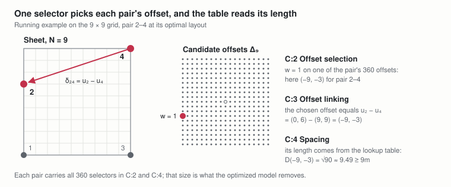

*C:2–C:4 · offset selection, linking, and spacing for pair 2–4*
For pair 2–4 of the running example, C:2 sets one selector to 1, C:3 makes that offset the leaves' actual difference, and C:4 reads its length from the lookup table.

**C:4 Spacing through the lookup table.** TreeMaker's pair constraint, with the Euclidean distance read from the table entry of the selected candidate.

```math
m\, \ell_{ij} \leq \sum_{\delta \in \Delta_N} D(\delta)\, w_{ij\delta} \qquad \forall\, \{i, j\} \in \mathcal{P}
```

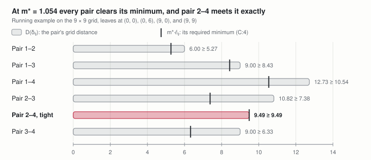

*C:4 · every pair's distance against its minimum at m\* = 1.054*
At the optimum every pair's grid distance reaches its required minimum, and pair 2–4 reaches it exactly: it is the tight pair that stops m from growing.

**Exactness.** The candidates in Δ\_N are distinct and exactly one is selected, so C:2 and C:3 force w to pick the candidate equal to the pair offset δᵢⱼ. C:4 then reads its exact length, so the four constraints together are TreeMaker's model restricted to grid points, with no approximation and no big-M constants. Excluding the zero offset also keeps two leaves off the same grid point.

```math
\text{C:1–C:4} \iff u_i \in G_N \ \ \forall\, i \in L \quad \text{and} \quad \|u_i - u_j\|_2 \geq m\, \ell_{ij} \ \ \forall\, \{i, j\} \in \mathcal{P}
```

**Optional TreeMaker conditions.** TreeMaker's position and symmetry constraints stay linear on the grid and can be added as needed. For example, a leaf on the sheet's left edge or in a corner, a mirrored pair under book symmetry, and a leaf on the symmetry axis (N even):

```math
x_i = 0, \qquad x_i = y_i = 0, \qquad x_a + x_b = N,\ y_a = y_b, \qquad 2 x_i = N
```

## 8. Objective

Maximize the scale, exactly as TreeMaker does. A larger m means longer flaps from the same sheet, so this maximizes paper usage.

```math
\max_{m,\, x,\, y,\, w} \quad m
```

At the optimum, m\* is set by the tight pairs (pairs exactly at their minimum distance), and their paths are the active paths, as in TreeMaker.

```math
m^{*} = \max_{u \in G_N^{\,L}} \ \min_{\{i, j\} \in \mathcal{P}} \frac{D(u_i - u_j)}{\ell_{ij}}
```

For the running example, m\* = 0.949 on an 8 × 8 grid, 1.054 on 9 × 9, and 1.197 on 10 × 10, all confirmed by exhaustive search. If the tree must keep its stated proportions with integer flap lengths (m = 1), the smallest grid that allows it is N = 9.

## 9. Behavior as N grows

The grid is the only approximation in this model: the lookup table gives exact Euclidean distances at every N. As the grid gets finer, the model's optimum converges to TreeMaker's. Write m\*\_N for the optimum on the N × N grid and m\_TM for TreeMaker's optimum on the unit square. The two sheets differ in size by a factor of N, so they compare through m\*\_N / N (Section 1). Two bounds squeeze it.

**Upper bound: the grid cannot beat TreeMaker.** Shrinking any feasible grid layout by a factor of N gives a feasible TreeMaker layout, because the grid points land in the unit square and every distance and the scale shrink by the same factor.

```math
\|u_i - u_j\|_2 \geq m\, \ell_{ij},\ \ u_i \in [0, N]^2 \quad \Longrightarrow \quad \Big\| \frac{u_i}{N} - \frac{u_j}{N} \Big\|_2 \geq \frac{m}{N}\, \ell_{ij},\ \ \frac{u_i}{N} \in [0, 1]^2 \qquad \text{so} \qquad \frac{m^{*}_N}{N} \leq m_{\mathrm{TM}}
```

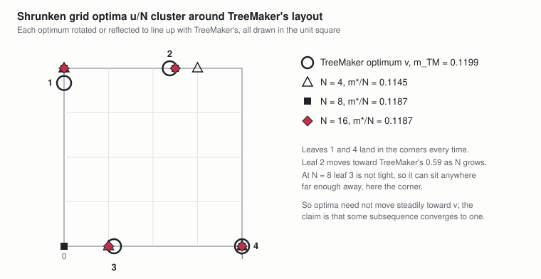

*upper bound · the 9 × 9 optimum shrunk into the unit square*
**Lower bound: rounding TreeMaker's layout loses little.** Take TreeMaker's optimal layout v, scale it to the N × N sheet, and move each leaf to its nearest grid point uᵢ. Each leaf moves at most half a grid diagonal, so by the triangle inequality each pair distance shrinks by at most √2.

```math
\|u_i - N v_i\|_2 \leq \tfrac{\sqrt{2}}{2} \quad \Longrightarrow \quad \|u_i - u_j\|_2 \geq N \|v_i - v_j\|_2 - \sqrt{2} \geq N\, m_{\mathrm{TM}}\, \ell_{ij} - \sqrt{2}
```

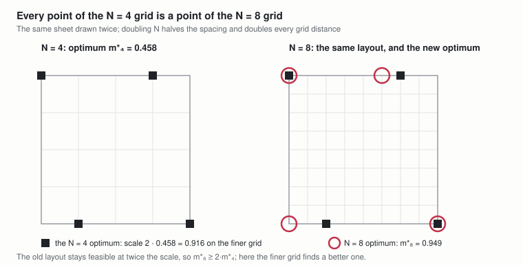

*lower bound · TreeMaker's layout rounded onto the 9 × 9 grid*
The rounded layout is therefore feasible at scale N·m\_TM − √2/ℓᵢⱼ for every pair, and the shortest leaf path ℓ\_min is the worst case. Once that scale is positive, no two rounded leaves coincide.

```math
m^{*}_N \geq N\, m_{\mathrm{TM}} - \frac{\sqrt{2}}{\ell_{\min}}, \qquad \ell_{\min} = \min_{\{i, j\} \in \mathcal{P}} \ell_{ij}
```

**The squeeze.** Dividing by N and combining the two bounds:

```math
m_{\mathrm{TM}} - \frac{\sqrt{2}}{N\, \ell_{\min}} \ \leq\ \frac{m^{*}_N}{N} \ \leq\ m_{\mathrm{TM}} \qquad \Longrightarrow \qquad \lim_{N \to \infty} \frac{m^{*}_N}{N} = m_{\mathrm{TM}}
```

The gap closes like 1/N, and the relative loss is at most √2 / (N·m\_TM·ℓ\_min), which says how fine a grid is fine enough for a given tree.

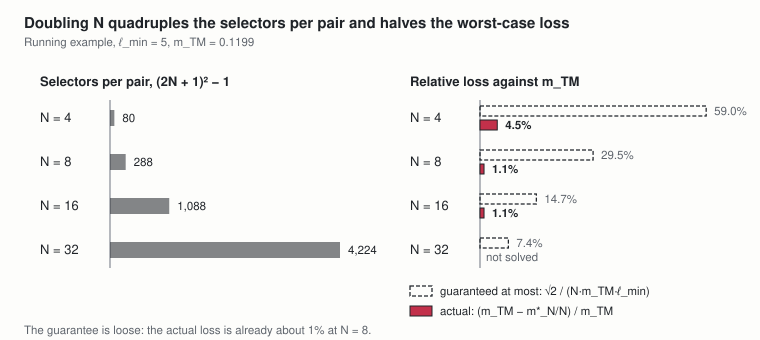

*the squeeze · m\*\_N / N for N = 2 to 16 between the two bounds*
**The layouts converge too.** The shrunken optimal layouts u/N all lie in the bounded, closed set \[0, 1\]²ⁿ, so they have convergent subsequences. The pair constraints are closed conditions, so every limit satisfies TreeMaker's constraints at scale m\_TM: it is a TreeMaker optimum. In that sense the model reduces to TreeMaker as N → ∞.

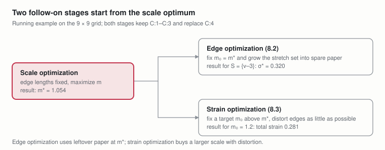

*the layouts converge · shrunken optima for N = 4, 8, and 16 against TreeMaker's layout*
**Refining the grid never hurts.** Doubling N puts every old grid point onto the new grid, with all distances doubled, so the scaled optimum cannot drop. Unrelated grid sizes need not improve in order: for the running example m\*\_N / N is 0.119 at N = 8, 0.117 at N = 9, and 0.120 at N = 10.

```math
m^{*}_{2N} \geq 2\, m^{*}_N
```


*refining never hurts · the N = 4 optimum embedded in the N = 8 grid*
**The cost of a finer grid.** Each pair has (2N + 1)² − 1 offset selectors, so the model grows quadratically in N. In practice N is chosen as a trade-off between the bound above and the model size.


*the cost of a finer grid · selectors per pair against the loss bound*
## 10. Cost trade-offs

The formulation buys linearity and exactness with size. Every nonlinear distance becomes a choice among precomputed offsets, so the number of integer variables, and with it the solve time, grows quickly with both the tree and the grid.

**Variable counts.** The leaf coordinates are few; the offset selectors dominate, with one binary per leaf pair per candidate offset.

```math
\underbrace{2n}_{\text{integer coordinates}} \;+\; \underbrace{\tfrac{n(n - 1)}{2} \big( (2N + 1)^2 - 1 \big)}_{\text{binary offset selectors}} \;+\; \underbrace{1}_{m} \;=\; O(n^2 N^2)
```

| Leaves n | Pairs | N = 9 | N = 16 | N = 32 |
| --- | --- | --- | --- | --- |
| 4 | 6 | 2,160 | 6,528 | 25,344 |
| 20 | 190 | 68,400 | 206,720 | 802,560 |
| 50 | 1,225 | 441,000 | 1,332,800 | 5,174,400 |

The count is quadratic in each direction: doubling the number of leaves or the grid size multiplies it by about four. The constraints are few, four rows per pair, but dense: each pair's C:2 and C:4 rows touch all (2N + 1)² − 1 of its selectors, so the constraint matrix has O(n²N²) nonzeros as well.

**Solve time.** The underlying problem is NP-hard (circle packing for origami design is hard even in its continuous form), and MILP solvers attack it with branch-and-bound. They solve the LP relaxation, the same model with the integer requirements dropped, use its value as a bound to discard branches, and branch on variables that come out fractional. How well that works depends on the problem, and three of this problem's properties work against it. None is a component of the model that could be left out; each is a limitation the solver meets.

- **The LP relaxation gives a weak bound.** In the relaxation, selectors may take fractional values. A pair can then put half its weight on an offset δ and half on −δ: C:3 sees an average offset of zero while C:4 still reads a long distance. Every leaf can sit on the same grid point, and the relaxation reaches the diagonal bound m̄ of D:3 whatever the tree. This comes from the problem, not from a modelling choice: "far apart" is a nonconvex requirement, and averaging two far-apart placements gives a close one. Natural linear formulations share the weakness to some degree (the optimized model's big-M constraints do too), so the solver must close the gap by branching.
- **Symmetry.** The square sheet has eight symmetries, a layout with slack (room to spare between leaves and the sheet's edges) can be translated, and interchangeable sibling leaves can swap. Each gives equal-valued solutions, and branch-and-bound explores every copy unless constraints cut them away.
- **Coupling.** Each leaf takes part in n − 1 pairs, so fixing one selector rarely settles the others, and branching makes slow progress.

As a rough guide, a handful of leaves on a grid of a dozen or so cells per side solves quickly, while trees with tens of leaves on fine grids are out of reach for this formulation as written; the exact boundary depends on the solver and the tree.

**Mitigations within this formulation.**

- **Prune offsets with a known scale.** Any feasible layout (one that meets every constraint) gives an achievable scale m\_L ≤ m\*, and every optimal layout then satisfies D(δᵢⱼ) ≥ m\_L·ℓᵢⱼ. Offsets shorter than that can be removed from Δ\_N pair by pair without losing an optimum. The rounded TreeMaker layout of Section 9 provides such a scale, and a starting solution.
- **Use the sign symmetry of the table.** D depends only on |δ₁| and |δ₂|, so selectors over (N + 1)² absolute offsets plus sign variables can replace the (2N + 1)² signed ones, at the cost of linearizing the signs.
- **Break symmetry.** Anchor one leaf in the fundamental domain 0 ≤ y ≤ x ≤ N/2 and order interchangeable siblings, as the optimized model does.
- **Choose N deliberately.** Section 9's bound gives the coarsest grid whose relative loss √2 / (N·m\_TM·ℓ\_min) is acceptable.

These help by constant factors. The structural fixes, which change the formulation itself, are the subject of Section 12.

## 11. Follow-on stages: edge and strain optimization

The model above keeps the tree's proportions and finds only its largest scale. TreeMaker refines a scale-optimized design in two further stages that let edges change length. Both carry over to the fixed grid unchanged in spirit: they keep C:1–C:3 and the lookup table, replace C:4, and hold the scale fixed so every constraint stays linear.

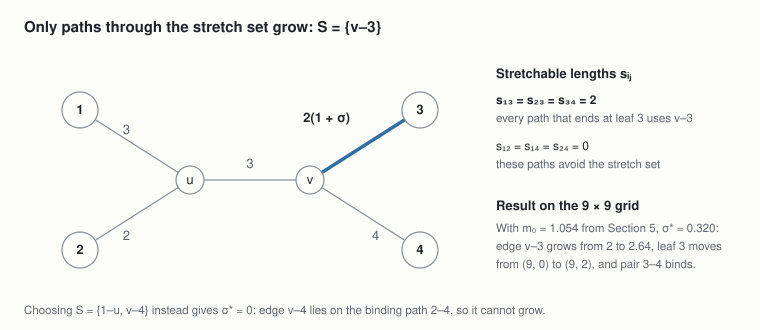

*the two follow-on stages · inputs and running-example results*
### 11.1 Additional parameters

**P:4 Fixed scale.** For edge optimization, the optimum m\* of Section 8. For strain optimization, a target scale, typically larger than m\*, at which the tree does not fit unstrained.

```math
m_0 > 0
```

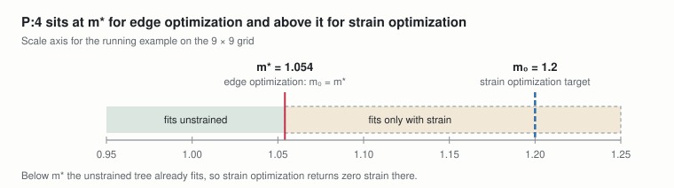

*P:4 · where each stage fixes the scale*
**P:5 Stretch set.** The edges allowed to lengthen in edge optimization, for example the legs of an insect.

```math
S \subseteq E
```

**P:6 Strain bounds.** Limits on each edge's relative change in strain optimization. The lower bound above −1 keeps every edge length positive.

```math
-1 < \sigma_{\min} \leq 0 \leq \sigma_{\max}
```

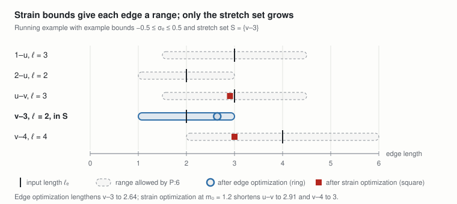

*P:5 and P:6 · stretch set and allowed edge-length ranges*
### 11.2 Edge optimization

**Variables.** The per-edge strains σₑ of strain optimization (11.3), tied to one common stretch σ: every edge in S lengthens by the same fraction, to ℓₑ(1 + σ), and every other edge keeps its length. The leaf coordinates and offset selectors of Section 6 stay as they are.

```math
\sigma_e = \sigma \ \ \forall\, e \in S, \qquad \sigma_e = 0 \ \ \forall\, e \in E \setminus S, \qquad \sigma \geq 0
```

**D:4 Stretchable path length.** The part of a pair's path length that lies on edges in the stretch set. Only this part grows when the stretch set lengthens.

```math
s_{ij} = \sum_{e \in \mathrm{path}(i, j) \cap S} \ell_e \qquad \forall\, \{i, j\} \in \mathcal{P}
```

Used in: constraint C:5.

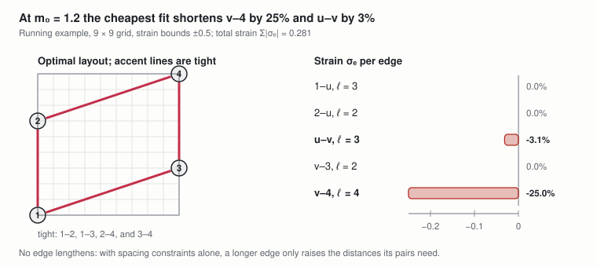

*stretch set S = {v–3} · stretchable path lengths and result*
**C:5 Stretched spacing.** Replaces C:4. It is the strained spacing C:6 of 11.3 with the strains above: a pair's strained path length ℓᵢⱼ + Σ ℓₑσₑ reduces to ℓᵢⱼ + σ·sᵢⱼ, so each pair's path grows by σ times its stretchable part (D:4), at the fixed scale.

```math
m_0 \Big( \ell_{ij} + \sum_{e \in \mathrm{path}(i, j)} \ell_e\, \sigma_e \Big) = m_0 \left( \ell_{ij} + \sigma\, s_{ij} \right) \leq \sum_{\delta \in \Delta_N} D(\delta)\, w_{ij\delta} \qquad \forall\, \{i, j\} \in \mathcal{P}
```

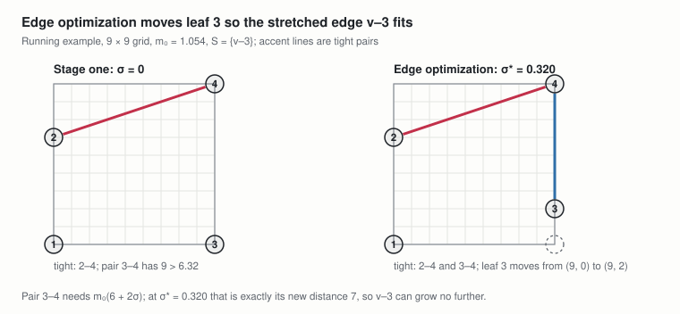

*C:5 · layout before and after edge optimization*
**Objective.** Make the chosen edges as long as the leftover paper allows.

```math
\max \quad \sigma \qquad \text{subject to C:1–C:3 and C:5}
```

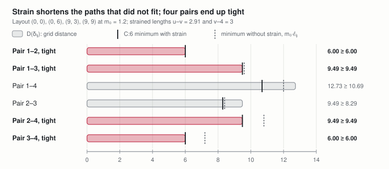

*C:5 · every pair against its stretched minimum at σ\* = 0.320*
The stage-one layout with σ = 0 is feasible, so it is a ready starting solution. Pairs with sᵢⱼ = 0 keep C:4 at scale m₀. If an edge of S lies on a pair that was binding (exactly at its minimum distance) in stage one, it may not be able to grow at all.

Edge optimization is therefore strain optimization restricted to one common, nonnegative strain on S, and that strain is maximized rather than kept small.

### 11.3 Strain optimization

**Variables.** One strain per edge, now independent and signed, which changes edge e to ℓₑ(1 + σₑ), with its magnitude for the objective, plus the leaf coordinates and offset selectors of Section 6.

```math
\sigma_e \in [\sigma_{\min}, \sigma_{\max}], \qquad a_e \geq 0 \qquad \forall\, e \in E
```

**C:6 Strained spacing.** Replaces C:4. Each pair's path length becomes the sum of its strained edge lengths, which is linear in the strains.

```math
m_0 \left( \ell_{ij} + \sum_{e \in \mathrm{path}(i, j)} \ell_e\, \sigma_e \right) \leq \sum_{\delta \in \Delta_N} D(\delta)\, w_{ij\delta} \qquad \forall\, \{i, j\} \in \mathcal{P}
```


*C:6 · optimal strained layout and strain per edge at m₀ = 1.2*
**C:7 Strain magnitude.** Each aₑ is at least the absolute value of its strain.

```math
a_e \geq \sigma_e, \qquad a_e \geq -\sigma_e \qquad \forall\, e \in E
```

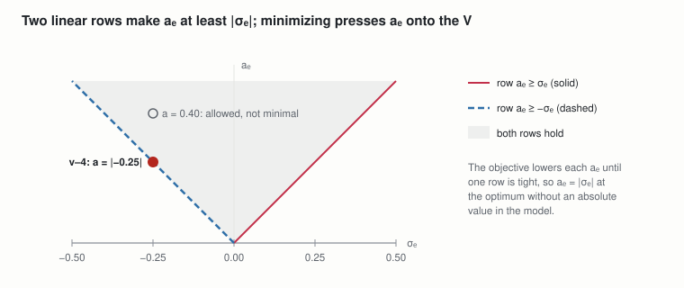

*C:7 · two rows that linearize |σₑ|*
**Objective.** Make the tree fit at the target scale with as little total strain as possible.

```math
\min \quad \sum_{e \in E} a_e \qquad \text{subject to C:1–C:3, C:6, and C:7}
```


*strain objective · every pair against its minimum with and without strain at m₀ = 1.2*
TreeMaker minimizes the sum of squared strains instead. SCIP can solve that convex quadratic objective too, but the absolute-value form keeps the model a MILP. Minimizing the largest strain (a\_max ≥ aₑ for every edge, then minimize a\_max) spreads the distortion evenly instead. With only spacing constraints, lengthening an edge never helps, so optimal strains are zero or negative unless position or symmetry conditions force otherwise. If m₀ ≤ m\*, the optimum is zero strain.

## 12. From this model to the optimized model

[Optimized MILP TreeMaker](https://claude.ai/artifact/LxhWqnKYWWuTrdmJ3hrKdq) keeps this model's problem and its optimum, and shrinks the computation in four steps, one section each, in this order. None of them loses a layout this model allows.

1. **Lattice hulls at a fixed scale (its Section 3).** Fix the scale for each solve and ask whether a layout exists. A pair then needs only to know whether its offset is too short, and the too-short offsets fill a lattice polygon, so one binary per side, at most 48 per pair on a 32 × 32 grid, replaces (2N + 1)² − 1 = 4,224.
2. **Symmetry breaking (its Section 4).** Anchor one leaf in a fundamental domain of the square (a region holding one copy of each point under the square's 8 symmetries) and order interchangeable sibling leaves (same parent, equal edge length).
3. **Scale search (its Section 5).** The optimal scale is always a lookup-table distance divided by a path length, so a bisection over those values finds m\* in about log₂ of their number of tests: 8 for the running example.
4. **Incremental solving (its Section 6).** Each fixed-scale test starts from a few pairs, small polygons, and leaves confined to windows, and adds only what a solution violates. A full-grid solve stands behind every "no".

|  | This model | Optimized model |
| --- | --- | --- |
| Objective | Maximize m at fixed N | Same, found by bisection over candidate scales |
| Leaf positions | Grid points of a fixed N × N sheet | Same |
| Spacing | Offset selectors plus distance lookup table | Lattice-hull facets at the trial scale |
| Binaries per pair | (2N + 1)² − 1 | One per crossable facet: O(N^(2/3)) |
| Big-M constants | None | Facet big-Ms |
| Solves | One | About log₂ of the number of candidate scales, each test a loop of small solves |
