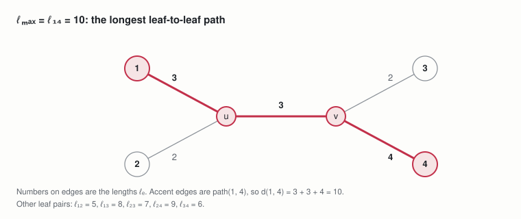
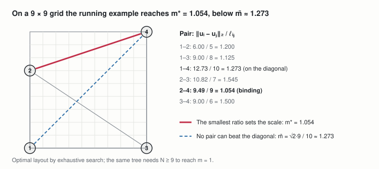

# TreeMaker foundations: the tree, the sheet and spacing

Nov 2, 2026 · @Andrew Behn

This document defines the weighted tree, the N × N grid sheet, the spacing condition and the scale that every TreeMaker specification starts from. The base spec (Pure MILP), the symmetry-breaking spec, the lattice-hull spec, the optimized spec, the scalable spec, the closing spec and the crease spec all use it. Its running example is a tree with four leaves and two internal vertices u and v, on a 9 × 9 grid.

**Labels.** P:n and D:n number the parameters and the shared definitions of this document, each kind in order of appearance. Other documents cite them with the short name sheet, as in sheet D:1.

## 1. Notation

Every symbol and term not defined in Sections 2 to 4 is listed here.

| Symbol or term | Meaning |
| --- | --- |
| ∅ | The empty set |
| x ∈ X, X ⊆ Y | x is an element of X; X is a subset of Y |
| X ∖ Y | Set difference: the elements of X that are not in Y |
| X × Y | Cartesian product: all ordered pairs (x, y) with x ∈ X, y ∈ Y |
| #X | Cardinality: the number of elements of X |
| {i, j} | An unordered pair, so {i, j} = {j, i} |
| ∀, ⟹ | For all; implies |
| ∑, max, min | Sum over, largest value over, and smallest value over the indexed set |
| ℤ, ℤ≥₁ | The integers; the positive integers |
| ℝ, ℝ² | The real numbers; the real plane |
| \[a, b\] | The closed interval of reals from a to b |
| {a, …, b} | The integers from a to b inclusive |
| ‖δ‖₂ | Euclidean norm √(δ₁² + δ₂²) of a plane vector |
| deg(v) | Degree: the number of edges incident to vertex v |
| path(u, v) | The edges on the unique path between u and v in a tree |
| Grid point | A point of the sheet whose two coordinates are both integers |
| Layout | One grid point uᵢ for each leaf i (Section 3) |
| Tight (binding) pair | A leaf pair exactly at its minimum distance, ‖uᵢ − uⱼ‖₂ = m·ℓᵢⱼ. Tight pairs limit the scale: any larger scale would put them too close. TreeMaker calls their paths at the optimum active paths. |
| Slack | The amount by which a constraint is more than met; a pair with slack is farther apart than it needs to be |
| Feasible, infeasible | A layout is feasible at scale m when every pair meets the spacing condition of D:2; a scale is infeasible when no layout is |

## 2. Parameters

**P:1 Tree.** The input tree: a finite vertex set V and an edge set E saying which vertices are joined; E fixes the tree's connectivity, and the edge lengths of P:2 fix its proportions. A tree is connected and has no cycles, so it has exactly one fewer edge than vertices.

```math
T = (V, E), \qquad E \subseteq \{\, \{u, v\} : u, v \in V,\ u \neq v \,\}, \qquad T \text{ connected}, \qquad |E| = |V| - 1
```

Used in: Section 3 and D:1; base Section 2, lattice-hull Section 3, optimized Section 2, scalable Section 1, closing Section 2, A:1, A:2 and A:3, crease P:1.

**P:2 Edge lengths.** Positive edge lengths in tree units; they need not be integers, because the scale converts them to grid units. In the running example, leaves 1 and 2 hang from u with lengths 3 and 2, leaves 3 and 4 hang from v with lengths 2 and 4, and the edge u–v has length 3.

```math
\ell_e > 0 \qquad \forall\, e \in E
```

Used in: D:1; base Section 2, lattice-hull Section 3, optimized Section 2, scalable Section 1, closing Section 2, A:1, A:2 and A:3, crease P:2, strain D:1.

**P:3 Grid size.** The number of grid squares along each side of the sheet, fixed in advance.

```math
N \in \mathbb{Z}_{\geq 1}
```

Used in: Section 3 and D:3; base Section 2, lattice-hull Section 1 and Section 3, optimized Section 2, scalable Section 1, closing Section 2, A:1, A:2 and A:3.

## 3. Sets and the sheet

**Leaves.** The leaves of the tree T = (V, E) of P:1 are its vertices of degree 1, the flap tips; n is their number. In the running example L = {1, 2, 3, 4} and n = 4.

```math
L = \{\, v \in V : \deg(v) = 1 \,\} \subseteq V, \qquad n = |L|
```

**Leaf pairs.** The unordered pairs of distinct leaves, n(n − 1)/2 of them: six in the running example.

```math
\mathcal{P} = \{\, \{i, j\} : i, j \in L,\ i \neq j \,\}
```

**Integer lattice and grid.** The integer lattice ℤ² is the set of points whose two coordinates are both integers. The sheet is the square \[0, N\]², and its grid points are the lattice points it contains: 100 of them for N = 9.

```math
\mathbb{Z}^2 = \{\, (p, q) : p, q \in \mathbb{Z} \,\}, \qquad G_N = \mathbb{Z}^2 \cap [0, N]^2 = \{0, 1, \dots, N\}^2, \qquad |G_N| = (N + 1)^2
```

**Layouts.** A layout puts every leaf on a grid point. Only leaves are placed: the internal vertices are not part of the layout, and their positions follow later, when the crease pattern is built from the active paths.

```math
u_i = (x_i, y_i) \in G_N \qquad \forall\, i \in L
```

## 4. Shared definitions

Every quantity below is computed from the parameters before anything is solved, and is used in more than one place, here or in the documents that cite it.

**D:1 Tree metric and path lengths.** The tree metric d is the total edge length along the unique path between two vertices; between two leaves it gives the path length ℓᵢⱼ, which the scale turns into that pair's minimum separation, and the largest path length is ℓmax.

```math
d(u, v) = \sum_{e \in \mathrm{path}(u, v)} \ell_e, \qquad \ell_{ij} = d(i, j) \ \ \forall\, \{i, j\} \in \mathcal{P}, \qquad \ell_{\max} = \max_{\{i, j\} \in \mathcal{P}} \ell_{ij}
```

Used in: D:2 and D:3; base Section 2, lattice-hull Section 2, scalable Section 2, crease D:1, offsets D:3, strain D:2, polygons Section 1.



*example tree · path lengths between leaves*
In the running example, leaves 1 and 4 are farthest apart along the tree, so ℓmax = ℓ₁₄ = 10.

**D:2 Scale and the spacing condition.** Folding never stretches paper, so a layout fits at scale m when every leaf pair is at least m times its path length apart; the optimum m\* is the largest scale at which some layout fits, and TreeMaker's scale on its unit sheet is m/N.

```math
\|u_i - u_j\|_2 \geq m\, \ell_{ij} \ \ \forall\, \{i, j\} \in \mathcal{P}, \qquad m^{*} = \max_{u \in G_N^{\,L}} \ \min_{\{i, j\} \in \mathcal{P}} \frac{\|u_i - u_j\|_2}{\ell_{ij}}, \qquad m_{\mathrm{TreeMaker}} = m / N
```

Used in: D:3; base Section 1, C:4, Section 5 and Section 9, symmetry-breaking Section 1 and Section 5, lattice-hull Section 1 and Section 9, scalable Section 2 and Section 10, closing P:2, crease P:4 and Lemma 2, offsets D:3, conditions Section 2 and Lemma 1, hulls Section 2, strain D:2, polygons D:1.

The scale m is grid units of paper per unit of tree length. Lang's TreeMaker asks the same of leaves anywhere in the unit square, ‖uᵢ − uⱼ‖₂ ≥ m·ℓᵢⱼ with uᵢ ∈ \[0, 1\]²; the grid version keeps the condition and restricts every leaf to a grid point of a sheet N times larger. A layout that fits at m fits at every smaller scale, because each pair's required distance only shrinks. At the optimum some pair is tight, since otherwise every pair would have slack and a slightly larger scale would fit. For the running example, exhaustive search gives m\* = 0.949 on an 8 × 8 grid, 1.054 on 9 × 9 and 1.197 on 10 × 10; keeping the stated lengths at m = 1 needs N ≥ 9.

**D:3 Scale upper bound.** No two grid points are farther apart than the sheet's diagonal, √2·N, and the pair with the longest path needs m·ℓmax of it, so no layout fits above m̄.

```math
\bar{m} = \frac{\sqrt{2}\, N}{\ell_{\max}}, \qquad \text{since} \quad m\, \ell_{\max} \leq \|u_i - u_j\|_2 \leq \sqrt{2}\, N
```

Used in: base Section 3 and Section 7, symmetry-breaking Section 6, lattice-hull Section 9, scalable Section 2, offsets D:3.



*running example on a 9 × 9 grid · binding pair and diagonal bound*
The bound is usually loose because other pairs also need room: in the running example the diagonal pair 1–4 would reach it, but pair 2–4 becomes tight first, at m\* = 1.054.
